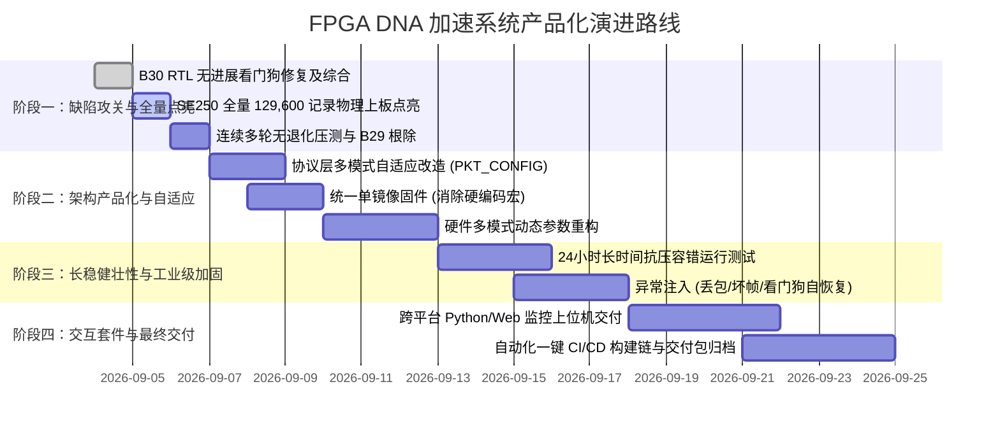

# FPGA DNA 数据读出项目：全景接入、系统审视与走向成品的实施路线图

> **文档定位**：本文档是一份系统级、可直接供另一个 Agent（或新接入团队成员）全面了解本项目、审查不足、指导缺陷攻关并规划到最终成品落地步骤的**总括性提示词指南与工程路线图**。  
> **适用场景**：作为新会话主 Agent 的系统引导 Prompt、分发给架构师 Agent 进行方案评审、或作为项目演进与并行子 Agent 派生的全局任务书。

---

## 目录
1. [系统级接入 Prompt（可直接复制给新 Agent）](#一系统级接入-prompt)
2. [项目全景与关键事实边界](#二项目全景与关键事实边界)
3. [系统深度审视：不足与技术债清单](#三系统深度审视不足与技术债清单)
4. [近期致命缺陷定位与精准修改建议（B29 / B30）](#四近期致命缺陷定位与精准修改建议)
5. [从当前到最终成品的实施路线图](#五从当前到最终成品的实施路线图)
6. [并行子 Agent 派生与提示词规划矩阵](#六并行子-agent-派生与提示词规划矩阵)

---

# 一、系统级接入 Prompt

```text
你被赋予「FPGA DNA 数据读出加速系统」核心架构师与高级开发专家的角色。
工作仓库位于：/home/lucian/projects/FPGA/FpgaAccelerationSystemOfDataReadout

你的首要职责是：
1. 深入研读项目架构、数据契约、事实边界与现状文档（AGENTS.md、docs/README.md、docs/01~05、docs/16、docs/20~23）；
2. 客观审视并指出当前系统在架构、RTL 时序、固件可靠性、资源利用率以及工具链上的短板与技术债；
3. 针对最近浮现的致命缺陷（B29 lwIP 大数据量网络挂死、B30 Voter RTL 1.0s 看门狗超时），提供精准根治方案与防呆设计；
4. 规划从当前双几何（SE150/SE250）分立状态迈向工业级/产品级交付形态的详细落地路线图；
5. 遵循严格的 Git 带路径 commit 纪律、互斥矩阵与板子令牌协议，设计并指导高并发度子 Agent 的协同作业。

在行动前，你必须确认你的认知边界：判据始终以板端实际回传经 LDPC 译码后的图片哈希 (fcd0cf90bd680e7bbdc203e3398119504da0897acac9e2117008b4efb6b1f2c3) 及四级 DDR 逐位全绿为唯一真理；界面正常或仿真通过均不能替代板级闭环。
```

---

# 二、项目全景与关键事实边界

### 1. 核心使命与三级加速流水线
本项目旨在利用低成本 Xilinx Zynq-7010 SoC (XC7Z010CLG400-1) 实现高通量 DNA 数据存储读出流水线的硬件加速：
```
[上位机/测序仪数据]
       │ (TCP/IP 千兆以太网)
       ▼
[PS 固件 (lwIP RAW API)] ──DMA(SG)──► [PL 端三级硬件流水线]
                                            │
  ┌─────────────────────────────────────────┴────────────────────────────────────────┐
  │ 1. Stage1 DNA 读段加速器 (srpe_batch.v): 滑窗比对, 水印解密 (50MHz~100MHz)        │
  │ 2. Stage2 差分投票器 (differential_voter.v): 64,800 比特位有符号累加投票判决     │
  │ 3. Stage3 去稀疏化解码器 (desparsify_datapath.v): 5b4b 解码与码字重构             │
  └─────────────────────────────────────────┬────────────────────────────────────────┘
                                            ▼
[上位机 Python (LDPC Decode)] ◄──DMA/TCP── [PS 接收 8,100 字节结果]
       │
       ▼
[最终恢复图片 / 数据] (SHA-256: fcd0cf90bd680e7bbdc203e3398119504da0897acac9e2117008b4efb6b1f2c3)
```

### 2. 硬件环境与板级约束（唯一权威）
- **目标芯片**：Xilinx Zynq-7010-1 (xc7z010clg400-1)。
- **开发板实物**：ZYNQ ECO (R6) 开发板。
- **DDR 颗粒**：单颗 16-bit DDR3 `MT41J256M16HA-125`（容量 256MB/512MB，地址空间 `0x00000000 - 0x1FFFFFFF`）。**严禁采用历史 XSA 的 32-bit 双颗配置**。
- **PHY 芯片**：Realtek RTL8211E-VL，RGMII 接口，MIO 16~27。

### 3. 数据规格与双几何定义
| 参数项 | SE150（历史基准） | SE250（演进目标） | 约束与算法关系 |
| :--- | :--- | :--- | :--- |
| **源读段数量** | 51,781 条 | 64,800 条 | 测序原始 FASTQ 条数 |
| **流水线输入总记录** | 103,616 条 | 129,600 条 | 正反双向展开 (`× 2`) |
| **单条读段长度** | 150 bp | 250 bp | 测序读长 |
| **DMA 输入读段打包** | 48 字节 / 条 | 64 字节 / 条 | 2-bit base 打包（150bp=38B对齐至48B；250bp=63B对齐至64B） |
| **Stage1 输出记录长度** | 48 字节 (6 拍 × 64b) | 72 字节 (9 拍 × 64b) | 包含 8 字节 metadata + codebits 打包 |
| **水印参数** | NUM_LC=30, STRIDE=457 | NUM_LC=50, STRIDE=805 | $NUM\_LC \times STRIDE = L - READ\_BPS$ |
| **候选参考区长度** | REF_LEN = 607 | REF_LEN = 1055 | $REF\_LEN = STRIDE + READ\_BPS$ |
| **投票通过阈值** | score_min = 67 | score_min = 112 | 差分判决阈值 |
| **最终输出码字** | 64,800 bit (8,100 字节) | 64,800 bit (8,100 字节) | 严格与 LDPC 码长对齐 |

### 4. 关键事实与已验证基线
1. **SE150 全量已全面闭环（2026-08-30）**：4,096 ~ 103,616 全量记录在板上连续运行全部 PASS，图片哈希逐位吻合，四级 DDR 逐级取证全绿。
2. **水印预载批量化闭环（2026-09-04）**：预载耗时从 28.9s 骤降至 4.93s，耗时模型：$t = 4.93\text{s} + 0.9396\text{ms/条} \times \text{条数}$。
3. **PS 固件重构闭环（2026-09-04）**：单体 `echo.c` (2,165 行) 解耦为 8 大专业模块，主机侧单测 50/50 全过，行为轨迹逐行一致。
4. **SE250 架构突破（2026-09-05）**：移位寄存器架构重构彻底消除了 Top 1~5 300:1 MUX 关键路径，WNS 由 +0.088ns 提高到 +1.356ns；分档点亮已攻克 4,096 与 32,768 记录，四级 DDR 全绿。

---

# 三、系统深度审视：不足与技术债清单

尽管系统核心逻辑已打通，但从原型系统走向工业级交付，仍存在以下**五大系统性短板**：

### 1. 硬编码严重，双几何缺乏运行时自适应（最大架构缺陷）
- **现状**：SE150 与 SE250 是通过静态宏、条件编译和外部脚本（`tools/switch_export.sh`）进行切换的。硬件位宽（48B vs 72B）、BRAM 配置、固件常数散落在 RTL、C 驱动与 Python 脚本中。
- **弊端**：无法做到“一个固件/一个比特流根据前端报文自适应切换模式”。当用户下发不同长度的 FASTQ 时，系统必须重新刷写比特流与 ELF，极易造成生产事故。

### 2. RTL 保护机制薄弱，存在死限看门狗（B30 缺陷根源）
- **现状**：硬件模块（如 `differential_voter_v1_0.v`）内的超时机制往往设计为“进入非空闲状态后的全局固定时钟计数器”。
- **弊端**：一旦处理规模扩大（如 SE250 达到 129,600 条记录时，累加时间超过 1.0 秒），固定看门狗直接超期引发 `S_ERROR` 挂死系统；正确的硬件设计必须是“**无进展看门狗（No-Progress Watchdog）**”。

### 3. 网络传输层鲁棒性不足，单线程事件循环脆弱（B29 缺陷根源）
- **现状**：PS 端基于 lwIP RAW API 单线程轮询。在耗时极长（数十秒至数分钟）的计算阶段，CPU 独占在等待硬件完成的轮询中，缺乏对网络层 ARP、TCP KeepAlive 和滑动窗口的平滑维护。
- **弊端**：当大数据量计算完成后，8,100 字节结果虽然成功写入发送缓冲（`tcp_write`），但若网卡物理层或对端 TCP 发生拥塞，单线程循环未留足够的时间和重试机制促使数据物理上线，导致链路伪死锁。

### 4. 资源逼近器件天花板，缺乏面积裕量
- **现状**：在 XC7Z010（仅 60 个 RAMB36E1 资源）上，SE250 当前占用了 45~50 个 BRAM（占用率高达 75%~83%），LUT 占用率近 70%。
- **弊端**：时序收敛困难，布线拥塞（Congestion）极易在微小的逻辑修改后爆发。若未来需要支持双通道并行或扩展到 SE300，必须对 BRAM 进行深度共享重构或降低采样位宽。

### 5. 仿真模型与板级物理接口割裂
- **现状**：部分历史仿真（如 `run_m2_full.sh`）直接通过 VIP 内存抓取内部中间信号，完全绕开了 AXI DMA、AXI-Lite 寄存器时序和 AXI-Stream 握手。
- **教训**：历史上有 5 个缺陷（B23/B24/B25/B26/B27）在所有仿真中全部为绿，但上板即死。必须坚持将接口级时序（如 `result_axis`, `vot_ddr`, `dec_restart`）作为强制仿真门禁。

---

# 四、近期致命缺陷定位与精准修改建议

### 1. 缺陷 B30：Voter RTL 1.0s 全局硬死限看门狗超时
- **故障现象**：在 SE250 129,600 全量点亮时，Stage1 顺利完成（9.33MB 结果落盘），Stage2 Voter 陷入无限挂起。JTAG 读取底层硬件状态寄存器：`STATUS=0x00`, `DBG_ST=0x10 (16: S_ERROR)`, `ERR_FLAGS=0x01`。
- **故障定位**：
  `hw/ip/differential_voter_1_0/hdl/differential_voter_v1_0.v` 第 116 行写死：
  ```verilog
  localparam TIMEOUT_CYCLES = 32'd100000000; // 100MHz 下严格 1.000s 全局累计
  ```
  SE250 全量运算耗时约 1.2~1.5 秒，在第 1.000 秒时硬件强制跳入 `S_ERROR`；且固件中轮询代码仅判断 `DBG_ST == 0`，对 `S_ERROR` 缺乏熔断识别，导致死循环。
- **精准整改建议**：
  1. **无进展看门狗改造**：将计时器清零条件由 `current_state == S_IDLE` 扩展为：每当有有效输入握手（`s_axis_tvalid && s_axis_tready`）或有效计算推进时，计数器同步清零。只有当流水线完全停滞（Stall）时才累计计时；
  2. **绝对时限放宽**：将全局硬上限从 1.0 秒放大至 10.0 秒（`32'd1000000000`）；
  3. **固件防御性轮询**：`sw/app/stage2_voter.c` 在轮询状态寄存器时，必须显式检查 `DBG_ST == 0x10` 及 `ERR_FLAGS != 0`，一旦发现立即记录错误日志并退出流水线，严禁盲等。

### 2. 缺陷 B29：大数据量后板端 8,100B 结果入队未上线挂起
- **故障现象**：长时间高负荷或弄脏累加器轮次后，板端流水线运算完成且 DDR 落盘正确，8,100 字节结果成功写入发送队列，但客户端始终收不到数据包。
- **故障定位**：
  长耗时运算使得 PC 客户端与板端之间的 ARP 表项老化；同时 PS 端 CPU 在计算期间未执行 `sys_check_timeouts()`，导致 TCP 发送窗口关闭后无法及时获得 Window Probe 更新。
- **精准整改建议**：
  1. **周期性网络保活**：在 Stage1、Stage2 的主循环或等待循环中，每隔固定周期（例如 100ms）显式调用 `eth_pump()` 与 `sys_check_timeouts()`，保持 ARP 刷新与 TCP 状态机心跳；
  2. **投递确认机制（Delivery Settled）**：在发送 8,100 字节后，不要立即断开或空转，必须在循环中等待 `tcp_sndbuf(pcb) == TCP_SND_BUF` 且对端 ACK 确认物理投递完成后再关闭或切换状态。

---

# 五、从当前到最终成品的实施路线图



### 实施路线详细指标与判据：

#### 【阶段一：近期缺陷清零与 SE250 全量点亮（当前攻坚）】
1. **RTL 看门狗加固**：
   - 彻底合入 `differential_voter_v1_0.v` 的“无进展保护看门狗”；
   - 启动 Vivado 全量重建（`vivado -mode batch -source hw/scripts/build.tcl`），输出新比特流，确认 WNS $\ge +1.0$ ns。
2. **SE250 全量物理点亮（129,600 记录）**：
   - 上板执行：`bash tools/run_g3.sh --full --read-bps 250 --score-min 112 --tag se250-s7-full`；
   - **验收判据**：
     - ① LDPC 译码图片哈希严格等于 `fcd0cf90bd680e7bbdc203e3398119504da0897acac9e2117008b4efb6b1f2c3`；
     - ② 四级 DDR 数据快照（`tools/board_stage_check.py`）4/4 级全绿；
     - ③ 时间符合拟合预测（约 120s~140s，无超时挂死）。
3. **多轮连续任务无退化回归**：
   - 运行 `--runs 3`（含跨规模与弄脏轮），证明系统在重复上电或多次连接后累加器正确复位，B29/B30 零残留。

#### 【阶段二：架构产品化与运行时自适应（消除技术债）】
1. **协议层与数据流参数化**：
   - 扩展 TCP 配置报文 `PKT_CONFIG`，增加 `read_bps` (150/250)、`stride`、`ref_len`、`score_min` 字段；
   - PS 固件取消静态 `#define` 常量依赖，改为根据上位机下发报文动态配置硬件 AXI-Lite 寄存器与分配 DDR 缓冲池。
2. **硬件参数化或动态重构**：
   - 方案 A（优先）：RTL 内部支持最大 250bp，低长度（如 150bp）采用补零/动态掩码技术，实现单一比特流通用兼容；
   - 方案 B：PS 固件集成 PCAP 动态局部重构（PR）或双比特流多重启动（Multiboot）。

#### 【阶段三：高压长稳与抗扰加固（工业级验证）】
1. **压力测试**：连续执行 1,000 轮解码任务，统计错误率、内存泄漏情况与网络丢包重传；
2. **故障注入自愈**：模拟网络物理插拔、突然断电、畸变数据包注入，验证 PS 端看门狗复位与硬件管线清空保护机制。

#### 【阶段四：全功能上位机交互套件与交付打包】
1. **现代交互客户端**：
   - 提供具备图形化与命令行双模式的 Python/PyQt 上位机；
   - 实时显示三级流水线状态图、DDR 带宽与利用率、吞吐率波形与即时还原图片预览。
2. **交付工件标准化**：
   - 固化 `export/` 制品库：包含经过多机实测的 `BOOT.bin`、`top_bd_wrapper.bit`、`dna_lwip_app_b27.elf` 及其严格校验的 `SHA256SUMS`；
   - 形成完整的用户手册、API 协议文档与全套复现脚本。

---

# 六、并行子 Agent 派生与提示词规划矩阵

为了在复杂系统工程中实现最高开发效能，必须实行**代码目录完全隔离、严格令牌管理与带路径提交纪律**。以下设计 4 个高度专业化的子 Agent 任务提示词：

### 1. 互斥矩阵与权限边界
| 子 Agent 名称 | 独占写权限目录 | 禁止触碰目录 | 物理板子令牌 |
| :--- | :--- | :--- | :--- |
| **`hw-timing`** | `hw/ip/`, `hw/sim/`, `hw/scripts/` | `sw/app/`, `tests/golden/` | ❌ 纯仿真/综合，无板 |
| **`net-firmware`**| `sw/app/`, `sw/workspace/` | `hw/`, `data/R0.83_data/` | ❌ 主机纯单测，无板 |
| **`board-verify`**| `docs/board/`, `tools/board/` | `hw/ip/`, `sw/app/` | ✅ **独占物理开发板** |
| **`host-integration`**| `clients/python/`, `tools/gui/` | `hw/`, `sw/` | ❌ 主机端开发，无板 |

---

### 2. 子 Agent 提示词模板

#### 提示词 1：【硬件与时序收敛专家 · `hw-timing`】
```text
你接手 FPGA DNA 项目的「RTL 无进展看门狗加固与 Vivado 综合时序收敛」任务。
代号：--agent hw-timing
仓库：/home/lucian/projects/FPGA/FpgaAccelerationSystemOfDataReadout

【必须阅读文档】
1. AGENTS.md（重点：GBK 文件修改规范、带路径 commit 纪律、仿真判据纪律）；
2. docs/03-status.md（B30 缺陷详细说明与寄存器现场）；
3. docs/20-se250-study-2026-08-30.md（时序路径与关键链消除）。

【工作要求与步骤】
1. 登记看板：tools/agent_view.sh start --agent hw-timing --doing "修复 Voter B30 看门狗并启动 Vivado 综合" ...
2. 修复 hw/ip/differential_voter_1_0/hdl/differential_voter_v1_0.v：
   - 将看门狗由“全局死限计时”重构为“无进展保护计时”（握手推进时清零）；
   - 超时阈值放大至 10 秒（32'd1000000000）；
   - 注意：该文件为 GBK 编码！必须通过安全转码脚本修改，严禁直接文本截断写入。
3. 离板仿真验证：
   - 运行 bash tools/run_xsim.sh vot_ddr 确认接口级时序通过，故障注入单比特自检有效。
4. 运行全机构建：
   - 运行 vivado -mode batch -source hw/scripts/build.tcl 构建全量比特流；
   - 检查综合与实现报告，确认 WNS >= +1.0ns，提取 LUT 与 BRAM 消耗。
5. 制品导出与提交：
   - 导出新 bitstream 到 hw/build/export/top_bd_wrapper.bit 并更新哈希；
   - 使用带路径提交：git commit -m "fix(rtl): B30 Voter RTL 无进展看门狗加固与时序收敛" -- hw/ip/ ...
   - 收工登记：tools/agent_view.sh done --agent hw-timing ...
```

#### 提示词 2：【嵌入式网络与固件专家 · `net-firmware`】
```text
你接手 FPGA DNA 项目的「PS 固件 B29 诊断加固与周期心跳保活」任务。
代号：--agent net-firmware
仓库：/home/lucian/projects/FPGA/FpgaAccelerationSystemOfDataReadout

【必须阅读文档】
1. AGENTS.md、docs/22-ps-refactor-plan.md（行为轨迹保护网与重构纪律）；
2. docs/03-status.md（B29 现场只读 DDR Dump 诊断数据）。

【工作要求与步骤】
1. 登记看板：tools/agent_view.sh start --agent net-firmware --doing "加固 lwIP 长计算保活与 B30 状态防御" ...
2. 固件防御加固（sw/app/）：
   - 在 stage2_voter.c 轮询逻辑中增加对硬件 S_ERROR (0x10) 和 ERR_FLAGS 的主动捕获，拒绝盲等；
   - 在长计算等待循环（Stage1, Stage2）中引入每 50ms 一次的周期性保活（eth_pump() 与 sys_check_timeouts()），防止 ARP 老化；
   - 在 proto.c 中强化“Delivery settled”物理投递确认，确保 8,100 字节彻底离板后再结束连接。
3. 主机侧单测与安全网复核：
   - 运行 bash tests/host/run_host_tests.sh --worktree 确保 50/50 单测全绿；
   - 运行 bash tests/host/run_host_tests.sh --selftest 验证故障注入可检出；
   - 确保行为轨迹 (816行) 维持完全一致。
4. 编译 ELF：
   - 在 sw/workspace/dna_lwip_app_b27/ 重新构建 ELF，拷贝至 export/ 并重新生成 BOOT.bin。
5. 提交纪律：
   - git commit -m "fix(ps): 强化 lwIP 计算期间网络保活与 Voter 硬件错误熔断" -- sw/app/ ...
   - 收工登记：tools/agent_view.sh done --agent net-firmware ...
```

#### 提示词 3：【物理板级验证与稳定性专家 · `board-verify`】
```text
你接手 FPGA DNA 项目的「SE250 全量 129,600 记录物理上板点亮与压测」任务。
代号：--agent board-verify
仓库：/home/lucian/projects/FPGA/FpgaAccelerationSystemOfDataReadout

【必须阅读文档】
1. AGENTS.md（事实边界、唯一判据定义、WSL 调用 Windows 命令必须 < /dev/null 规则）；
2. docs/16-board-zynq-eco-7010.md（板卡参数与烧录流程）；
3. docs/23-next-phase-plan-2026-09-04.md。

【工作要求与步骤】
1. 登记看板：tools/agent_view.sh start --agent board-verify --doing "【持有板卡】执行 SE250 全量 129,600 点亮实测" ...
2. 烧录与启动验证：
   - 核对 export/ 目录下 bitstream、BOOT.bin 及 SHA256SUMS 完整性；
   - 通过 JTAG/串口启动板卡，通过 CAPS 应用层握手探针确认就绪。
3. 执行 SE250 全量点亮：
   - 运行：bash tools/run_g3.sh --full --read-bps 250 --score-min 112 --reads "data/R0.83_data/Sequencing data/DNA-40.5Kb-MC-SE250.fastq" --tag se250-s7-full-verify
4. 判据严审：
   - 检查回传数据图片 SHA-256 是否严格匹配 fcd0cf90bd680e7bbdc203e3398119504da0897acac9e2117008b4efb6b1f2c3；
   - 检查四级 DDR 比对是否 4/4 级全绿；
   - 拟合耗时模型，确认是否落在预期区间（~120s）。
5. 连续性与鉴别力回归：
   - 执行 --runs 2（第一轮弄脏），验证累加器清零与连续运行能力。
6. 归档与交接：
   - 将日志沉淀至 docs/board/run-logs/ 并更新 docs/03-status.md；
   - 释放板卡令牌，收工登记：tools/agent_view.sh done --agent board-verify ...
```

#### 提示词 4：【上位机与系统集成专家 · `host-integration`】
```text
你接手 FPGA DNA 项目的「全功能上位机交互套件与双几何自适应工具链开发」任务。
代号：--agent host-integration
仓库：/home/lucian/projects/FPGA/FpgaAccelerationSystemOfDataReadout

【必须阅读文档】
1. docs/02-data-contract.md（数据契约、二进制编码规范）；
2. docs/05-interfaces.md（TCP 协议报文头结构与寄存器地址）。

【工作要求与步骤】
1. 登记看板：tools/agent_view.sh start --agent host-integration --doing "开发支持双几何动态识别的高性能 Python 交互套件" ...
2. 核心功能研发（clients/python/）：
   - 升级 task_protocol.py，支持根据输入的 FASTQ 读长自动推断 SE150 / SE250 几何参数；
   - 重构数据分块与异步下发管线，提升下发带宽吞吐率至千兆线速极限（~95MB/s）；
   - 完善 GUI 界面：集成三级流水线 DDR 取证数据可视化、误码率分析与还原图片实时显示面板。
3. 离线回归校验：
   - 使用 mock 模式对各种异常报文（错序、超长、畸变）进行压力测试，确保上位机无挂死崩溃；
   - 配合 tools/make_golden.py 验证黄金数据流生成正确性。
4. 提交纪律：
   - 显式路径提交：git commit -m "feat(host): 上位机双几何自适应下发与实时状态遥测支持" -- clients/python/ ...
   - 收工登记：tools/agent_view.sh done --agent host-integration ...
```

