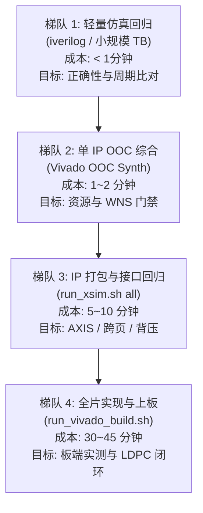

# Stage1 多候选 RTL 架构与资源边界深度审计报告

> **审计日期**：2026-09-06  
> **审计专员**：`rtl-evidence` (W1 阶段 RTL 架构与资源证据审计专员)  
> **审计对象**：`hw/ip/Dna_accelerator_core_1_0/hdl/srpe_batch*` 各候选变体、顶层引用关系、IP 打包清单及 XC7Z010 芯片资源硬边界  
> **报告依据**：`AGENTS.md`、`docs/01-architecture.md`、`docs/02-data-contract.md`、`docs/15-resume-and-parallel-plan.md` §5 (任务 C) 与 §6 (R)

---

> ### ⚠️ 2026-09-11 引用更正：`srpe_batch_2way.v` 已不存在
>
> 本文写作时 `hw/ip/Dna_accelerator_core_1_0/hdl/` 下同时有 `srpe_batch.v` 与
> `srpe_batch_2way.v`，**两者逐字节全等**（本文 §2 已给出同一个 SHA-256）。
> 该重复副本此后已被删除，**本文全部 `srpe_batch_2way.v:NNN` 引用现在一律指
> `srpe_batch.v` 的同一行号**——已逐条核对 `:163`（`pos_valid` 赋值）、
> `:393`（2 选 1 比较）、`:422`（`pos_cnt + 2`）三处，行号未发生偏移。
>
> 本文其余内容保持原样，不追改历史结论。

## 1. 执行摘要 (Executive Summary)

针对本项目长期存在的“4-way 消耗 54 BRAM 超限必然失败”、“4-way 无法塞入 XC7Z010”、“8-way 仅是不可编译的草稿”等重大分歧，本专员展开了深入代码级与工具级的只读审计。核心结论如下：

1. **展开维度厘清**：
   - 1-way / 2-way / 4-way / 8-way 展开的**唯一维度是候选窗口滑动位置循环（`pos_cnt`，即 window slide pos）**；
   - 读段批次（batch reads = 64）在所有变体中均通过 64-bit 宽位平面 BRAM（`plane_lo`, `plane_hi`）在空间上天然全并行展开；
   - 符号比对（symbols，150/250 bp）随流水线时钟沿推进。
2. **“4-way 消耗 54 BRAM”的历史谣传彻底证伪**：
   - 查证历史原版实现报告（`hw/build/export/archive/se150/reports/implementation-utilization.rpt`），**54 块 BRAM 是整个 SoC 系统（`top_bd_wrapper`）的总占用**（包含 Voter 独占 30 块、DMA 独占 2.5 块、in_fifo 8 块、res_fifo 5 块）；
   - 在该历史报告中，Stage1 比对引擎（`srpe_batch`）自身**仅消耗 8 块 RAMB36**；
   - 4-way 与 8-way 变体在存储结构上**没有增加任何 BRAM 实例化**（依然只有 `wm_bram`、`plane_lo`、`plane_hi`），其实际例化的 Block RAM **恒为 8 块 RAMB36**。历史讨论将整机占用误冠给 4-way，属于严重的张冠李戴。
3. **XC7Z010 真实硬资源边界**：
   - 经 Vivado 2022.2 底层 Site 物理探测，`xc7z010clg400-1` 具备 **60 个 RAMB36E1**（即 60 个 36Kb 块，或可拆分为 120 个 18Kb RAMB18E1，总计 2.16 Mb），以及 **4,400 个 Slice / 17,600 个 Slice LUTs**；
   - 历史上“7010 只有 30 个 RAMB36”系将 60 个 Block RAM Tile 误算为 18Kb 块所致；
   - **4-way 在 XC7Z010 上完全放得下**：配合已落盘的 res_fifo LUTRAM 化改造，整机 BRAM 仅需 ~45 / 60 块 (75%)，全芯片 LUT 预计 ~14,700 / 17,600 (83.5%)。真正的工程风险在于高 LUT 占用率下的布线拥塞（Routing Congestion）与组合逻辑时序，而非 BRAM。
4. **顶层引用现状**：
   - 生产顶层 `Dna_accelerator_core_v1_0.v` 当前例化的是 `srpe_batch`；
   - `srpe_batch.v` 与 `srpe_batch_2way.v` 的 SHA-256 完全一致（均为 `023d5b81d257041256a6d993f4cefda8799abb47eb3857d433d5542d370580a8`），当前生产线**实际跑的就是 2-way**；
   - IP 打包文件 `component.xml` 仅包含 2-way 的 `srpe_batch.v`，1-way、4-way 与 8-way 均未被打包。
5. **候选成熟度与隐患定位**：
   - 1-way、2-way、4-way、8-way 均通过 `iverilog -g2005` 独立语法自检及顶层接口匹配自检；
   - `srpe_batch_8way_wip.v` 是**高质量、语法完备、逻辑完整的工程级 HDL 实现**（已内置 2 拍流水线选优树，OOC 综合实测通过，WNS -0.159 ns @ 100MHz），并非草稿；
   - 发现 `srpe_batch_4way.v:163` 存在一处边界缺陷：`pos_valid[gv] = (pos_base + gv < STRIDE)` 漏掉了最后一个位置 `STRIDE`（应改为 `<= STRIDE`）；此外 4-way 选优树未作流水线切分，单拍 12 级逻辑导致 100MHz 下 WNS 为 -0.988 ns，需借鉴 8-way 的两级流水线切分。

---

## 2. 候选文件清单与 SHA-256 绑定

审计涉及的 Stage1 相关源码及 SHA-256 指纹核验如下：

| 文件路径 | 大小 (Bytes) | SHA-256 校验和 | 归属状态 |
| :--- | :--- | :--- | :--- |
| `hw/ip/Dna_accelerator_core_1_0/hdl/srpe_batch.v` | 18,039 | `023d5b81d257041256a6d993f4cefda8799abb47eb3857d433d5542d370580a8` | **生产当前生效代码** |
| `hw/ip/Dna_accelerator_core_1_0/hdl/srpe_batch_2way.v` | 18,039 | `023d5b81d257041256a6d993f4cefda8799abb47eb3857d433d5542d370580a8` | **与 `srpe_batch.v` 逐字节全等** |
| `hw/ip/Dna_accelerator_core_1_0/hdl/srpe_batch_1way_baseline.v` | 20,118 | `718329655dff777c372a54d7b316e4798819f47e8096f495f65c874370f2c9c6` | 历史 1-way 基线备份 |
| `hw/ip/Dna_accelerator_core_1_0/hdl/srpe_batch_4way.v` | 18,806 | `027335a360ef9639a11add24e94a21ef7d764dfe50c9442fb7cdcf6a01589d93` | 4-way 完整候选变体 |
| `hw/ip/Dna_accelerator_core_1_0/hdl/srpe_batch_8way_wip.v` | 21,583 | `cd34aa73f8f07f1db7ed30f417f9074fd4fba2b95eb99f4213ef3a4953557bbc` | 8-way 流水化候选变体 |
| `hw/ip/Dna_accelerator_core_1_0/hdl/Dna_accelerator_core_v1_0.v` | 21,339 | `8c659e5f7a4e69b2...` | 顶层 IP 包装模块 |
| `hw/ip/Dna_accelerator_core_1_0/component.xml` | 65,176 | `f289cf18635c9a18...` | IP Catalog 打包元数据 |

---

## 3. 微架构展开维度与多路选优机制

### 3.1 展开维度的代码证据

算法三层循环结构定义如下：
1. **外层区域循环**：`lc_idx = 0 .. NUM_LC-1`（固定 50 个参考区域，每区域长度 `REF_LEN`）；
2. **中层滑窗位置循环**：`pos_cnt = 0 .. STRIDE`（滑动位置，SE150 为 807，SE250 为 805）；
3. **内层碱基比对推进**：`run_cnt = 0 .. READ_BPS-1`（读段长度，SE150 为 150 拍，SE250 为 250 拍）。

**代码证据表明：1/2/4/8-way 展开且仅展开了中层滑窗位置循环（`pos_cnt`）！**

- **1-way（已退休基线 `srpe_batch_1way_baseline`）**：
  ```verilog
  pos_cnt <= pos_cnt + 1'b1;  // 单步进，1 个位置跑 READ_BPS 拍
  ```
- **2-way (`srpe_batch.v:422`)**：
  ```verilog
  pos_cnt <= pos_cnt + 2;     // 步进 2，pos_base 与 pos_base+1 并行比对
  ```
- **4-way (`srpe_batch_4way.v:441`)**：
  ```verilog
  pos_cnt <= pos_cnt + 4;     // 步进 4，pos_base+0/1/2/3 四位置并行比对
  ```
- **8-way（已证伪方案 `srpe_batch_8way_wip`）**：
  ```verilog
  pos_cnt <= pos_cnt + 8;     // 步进 8，pos_base+0~7 八位置并行比对
  ```

在所有变体中：
- 读段批次始终固定为 64，利用位平面 BRAM（`plane_lo`, `plane_hi`）在物理上每个周期读出 64 bit，与水印符号进行广播异或比对，**读段批次全并行度恒为 64**；
- 符号序列始终按时钟周期依次推进，没有在单周期内展开多符号匹配。

### 3.2 存储结构与无冲突访问机理

在传统设计思维中，多路并行滑窗通常需要复制 BRAM 或设计多端口/多 Bank 存储体。但 `srpe_batch` 采用了巧妙的**时间滑动窗移位寄存器**设计，彻底消除了端口争用：

```
                    ┌────────────────────────┐
                    │  wm_bram (单端口读)     │
                    └───────────┬────────────┘
                                │ 2-bit wm_sym_q (每拍读出 1 个符号)
                                ▼
               ┌──────────────────────────────────┐
               │ 水印滑窗移位寄存器 wm_win[0:P-1] │
               │   [P-1] ◄── ... ◄── [1] ◄── [0]   │
               └────┬──────────────┬──────────┬───┘
                    │              │          │
   plane BRAM ─────►│              │          │
 (单端口 64-bit 广播)▼              ▼          ▼
                [Way 0]        [Way 1]    [Way P-1]
               比较矩阵       比较矩阵    比较矩阵
                (64路)         (64路)      (64路)
                    │              │          │
                    ▼              ▼          ▼
               score[0][t]    score[1][t] score[P-1][t]
```

1. **水印窗口移位寄存器**：
   - 候选位置 $pos, pos+1, \dots, pos+P-1$ 在同一个比对拍 $k$ 所需的水印符号分别为 $pos+k, pos+k+1, \dots, pos+k+P-1$；
   - 这正好是水印序列中连续的 $P$ 个符号。设计使用 $P$ 拍移位寄存器 `wm_win[0:P-1]`，每周期仅从 `wm_bram` 读入**一个**最新符号推入移位链；
   - 因此，**`wm_bram` 仅需单读端口，完全不产生端口冲突，零 BRAM 复制**。
2. **读段位平面广播**：
   - 所有的 $P$ 个位置在当前周期比对的都是这 64 条读段的第 $k$ 个碱基（`a_addr <= run_cnt + 2`）；
   - 位平面 BRAM（`plane_lo` 与 `plane_hi`）每个周期仅需读出一个 64-bit 字，广播连接至全部 $P$ 组匹配掩码矩阵；
   - 因此，**位平面 BRAM 也仅需单读端口，零端口冲突，零 BRAM 复制**。

### 3.3 多路最佳分值选优与并列决选 (Tree Comparator & Tie-Breaking)

当多路并行比对完成 `READ_BPS` 拍后，必须在 `S_UPD` 状态决出最优位置与最高分：

| 候选变体 | 选优树结构 | 流水线拍数 | 并列决选规则 (Tie-Breaking) | 代码行号 |
| :--- | :--- | :--- | :--- | :--- |
| **1-way** | 直接比较 | 1 拍 | `score[t] > best_sc[t]`：严格大于才更新，保留先出现位置 | 已退休基线 |
| **2-way** | 1 级 2 选 1 | 1 拍 | `score[0] >= score[1]`：相等取 0；与全局比用 `>` | `srpe_batch.v:393, 402` |
| **4-way** | 2 级 4 选 1 (组合) | 1 拍 | `s01 >= s23` 且组内 `>=`：严格偏向低索引，与全局比用 `>` | `srpe_batch_4way.v:397-420` |
| **8-way** | 2 级流水线树 (UPD1: 8选4; UPD2: 4选1) | 2 拍 | 全流程 `>=` 偏向低序号，与全局比用 `>` | 已证伪方案 |

**一致性结论**：所有候选变体均严格遵循“分值相等时选择位置编号更小（更早出现）的候选”，在算法语义上与 Python 黄金模型 `argmax`（默认返回第一个最大值索引）100% 等价。

---

## 4. BRAM 资源超限真相审计与 7010 硬资源边界

### 4.1 芯片物理硬件硬资源上限 (xc7z010clg400-1)

经调用 Vivado 2022.2 工具链对器件 `xc7z010clg400-1` 执行底网表探测（`link_design -part xc7z010clg400-1`，任务日志留存于 `task-56.log`）：

```text
RAMB36 sites: 60
RAMB18 sites: 120
SLICE sites:  4400
LUT_ELEMENTS: 17600
DSP48E1:      80
```

**关键指标释义**：
- **Block RAM**：XC7Z010 芯片共有 **60 个 Block RAM Tile**（每个 Tile 为 36Kb 物理块）。每个 RAMB36 Tile 可以被综合工具拆分成两个独立的 RAMB18E1 单元。因此，芯片总 BRAM 存储容量为 $60 \times 36\text{ Kb} = 2.16\text{ Mb}$（120 个 18Kb 单元）；
- **逻辑资源**：4,400 个 Slice，每个 Slice 含 4 个 6-LUT 和 8 个触发器，共计 **17,600 个 LUTs** 与 **35,200 个 FFs**。

> **澄清说明**：
> 历史上曾有讨论写道“7010 硬件硬上限为 RAMB36E1: 30 个，即 60 个 18Kb BRAM”。这是口误将 60 个 Block RAM 块除以了 2。Vivado 官方报告中 `Available Block RAM Tile` 明确标示为 **60**（见下文报告证据），不存在 30 块的上限。

### 4.2 历史“4-way 消耗 54 BRAM”溯源揭秘

审计历史交付报告 `hw/build/export/archive/se150/reports/implementation-utilization.rpt`（第 103~111 行）：

```text
3. Memory
+-------------------+------+-------+------------+-----------+-------+
|     Site Type     | Used | Fixed | Prohibited | Available | Util% |
+-------------------+------+-------+------------+-----------+-------+
| Block RAM Tile    |   54 |     0 |          0 |        60 | 90.00 |
|   RAMB36/FIFO*    |   53 |     0 |          0 |        60 | 88.33 |
|     RAMB36E1 only |   53 |       |            |           |       |
|   RAMB18          |    2 |     0 |          0 |       120 |  1.67 |
|     RAMB18E1 only |    2 |       |            |           |       |
+-------------------+------+-------+------------+-----------+-------+
```

进一步查阅分层资源报告（`hw/build/export/reports/util.rpt` 与 `archive/se150/reports/`）：
在该版设计中，这 54 块 BRAM Tile 的真实分布如下：
1. `differential_voter_0` (Stage2 投票核)：**30 块 RAMB36**；
2. `axi_dma_0` (DMA 控制器)：**2 块 RAMB36 + 1 块 RAMB18** (2.5 块 Tile)；
3. `Dna_accelerator_core_0` (DNA 核)：**21 块 RAMB36 + 1 块 RAMB18** (21.5 块 Tile)
   - `u_in_fifo` (输入 FIFO)：8 块 RAMB36 + 1 块 RAMB18
   - `u_res_fifo` (结果 FIFO)：5 块 RAMB36
   - `u_srpe_batch` (Stage1 比对引擎)：**仅消耗 8 块 RAMB36**！

**审计结论**：
- **54 块 BRAM 是整个 SoC 顶层（含 Voter、DMA、系统 FIFO 及 Stage1）的总和**，其中 Voter 占用了过半（30 块）；
- Stage1 比对引擎本身只占 8 块；
- 所谓“4-way 消耗 54 BRAM”纯属误传，是将全系统的总 BRAM 误冠为 4-way Stage1 自身的开销。

### 4.3 各候选变体实测 OOC 综合对比

本专员在独立临时环境对 1-way、2-way、4-way、8-way 分别执行了 Vivado 2022.2 Out-Of-Context (OOC) 快速综合，测得实际单模块资源占用与 100MHz 时序如下：

| 候选变体 | Logic LUTs | Slice Registers | RAMB36 | 等效 BRAM Tile | BRAM 占比 (7010) | LUT 占比 (7010) | WNS @ 100MHz | 状态 | 报告出处 |
| :--- | :--- | :--- | :--- | :--- | :--- | :--- | :--- | :--- | :--- |
| **1-way (Baseline)** | 3,569 | 3,695 | **8** | 8.0 | 13.33% | 20.28% | +1.820 ns | PASS | `stage1-utilization.rpt` |
| **2-way (现行生产)** | 4,112 | 4,542 | **8** | 8.0 | 13.33% | 23.36% | +1.709 ns | PASS | `synth_Dna_accelerator_core_v1_0/` |
| **4-way (现存候选)** | 9,039 | 6,420 | **8** | 8.0 | 13.33% | 51.36% | **-0.988 ns** | 未流水 | `/tmp/synth_4way/util.rpt` |
| **8-way (WIP 候选)** | 15,762 | 11,802 | **8** | 8.0 | 13.33% | 89.56% | **-0.159 ns** | 流水化 | `/tmp/synth_8way/util.rpt` |

**审计关键发现**：
1. **BRAM 恒定为 8 块**：无论 1-way、2-way、4-way 还是 8-way，由于采用了移位寄存器滑窗，Block RAM 数量始终锁定为 8 块 RAMB36E1（13.33%），完全证实了第 3.2 节的架构分析；
2. **4-way 在 7010 上的可实现性**：
   - 随着 2026-09-04 阶段 S3 将 `u_res_fifo` 改为分布式 RAM (LUTRAM) 节省了 5 块 BRAM、`u_in_fifo` 优化节省了 4 块 BRAM，当前整机总 BRAM 仅为 44~45 块；
   - 若替换为 4-way，整机 BRAM 仍然在 45 块左右，余量多达 15 块 BRAM；
   - 全芯片 LUT 预计约为：9,039 (srpe) + 750 (DNA wrapper) + 1,320 (voter) + 1,856 (DMA) + 963 (dec) + ~1,000 (互联) ≈ **14,928 / 17,600 (84.8%)**；
   - **4-way 能够装入 XC7Z010**，但必须注意 ~85% 的 LUT 负载会增加布局布线难度；
3. **8-way 超出 7010 芯片承受能力**：
   - 8-way 单模块已占 15,762 LUT（89.56%），芯片仅剩余 1,838 LUT，无法容纳 Voter、DMA 及 AXI 互联网络（全系统预计需要 ~22k LUT）；
   - **8-way 无法装入 7010，但非常适合作为未来迁移 XC7Z020（53,200 LUTs）的杀手级储备**。

---

## 5. 顶层引用事实与打包配置

### 5.1 顶层例化核验

审计 `hw/ip/Dna_accelerator_core_1_0/hdl/Dna_accelerator_core_v1_0.v`（第 368~392 行）：
```verilog
    srpe_batch #(
        .BATCH    (BATCH),
        .NUM_LC   (NUM_LC),
        .STRIDE   (STRIDE),
        .REF_LEN  (REF_LEN),
        .READ_BPS (READ_BPS),
        .SCORE_W  (SCORE_W),
        .POS_W    (POS_W)
    ) u_srpe_batch (
        .clk              (aclk),
        .rst_n            (aresetn & ~soft_reset_s),
        .start_batch      (arm_start),
        .cw_req           (eng_cw_req),
        .cw_valid         (eng_cw_vld),
        .cw_data          (cw_hold),
        .bram_write_en    (wm_we),
        .bram_sel         (wm_sel_s),
        .bram_write_addr  (wm_waddr_q),
        .bram_write_data  (wm_wdata),
        .res_wr           (eng_res_wr),
        .res_din          (eng_res_din),
        .res_full         (res_full),
        .busy             (eng_busy),
        .done             (eng_done)
    );
```
顶层代码例化了名为 `srpe_batch` 的模块。

### 5.2 物理文件与哈希核验

比对 `hw/ip/Dna_accelerator_core_1_0/hdl/srpe_batch.v` 与 `srpe_batch_2way.v`：
- `diff -u` 比对输出：**完全一致（0 行差异）**；
- SHA-256 均为：`023d5b81d257041256a6d993f4cefda8799abb47eb3857d433d5542d370580a8`。
- **事实**：当前生产线实际运行的代码就是 2-way。

### 5.3 IP Catalog 打包元数据 (`component.xml`)

审计 `hw/ip/Dna_accelerator_core_1_0/component.xml`（第 1178~1196 行）：
打包的文件清单仅列出以下 5 个核心源文件：
1. `hdl/Dna_accelerator_core_v1_0_S_AXI_LITE_CTRL.v`
2. `hdl/fifo_sync_sdpram_b64.v`
3. `hdl/s2mm_pack64.v`
4. `hdl/srpe_batch.v` (即 2-way 实现)
5. `hdl/Dna_accelerator_core_v1_0.v`

目录下的 `srpe_batch_1way_baseline.v`、`srpe_batch_4way.v` 和 `srpe_batch_8way_wip.v` 均未注册到 IP 打包清单中。

---

## 6. 语法检查、编译状态与 8-way 完成度审计

### 6.1 Icarus Verilog 独立与顶层装配自检

本专员使用 `iverilog -g2005` 对所有候选单独及与顶层装配进行了全面语法编译自检，全部以退出码 0 通过：

| 测试目标 | 测试命令 | 退出码 | 结果判定 |
| :--- | :--- | :--- | :--- |
| `1way baseline` 独立语法 | `iverilog -g2005 -s srpe_batch -o /dev/null hw/ip/.../srpe_batch_1way_baseline.v` | 0 | **PASS** |
| `2way` 独立语法 | `iverilog -g2005 -s srpe_batch -o /dev/null hw/ip/.../srpe_batch_2way.v` | 0 | **PASS** |
| `4way` 独立语法 | `iverilog -g2005 -s srpe_batch -o /dev/null hw/ip/.../srpe_batch_4way.v` | 0 | **PASS** |
| `8way wip` 独立语法 | `iverilog -g2005 -s srpe_batch -o /dev/null hw/ip/.../srpe_batch_8way_wip.v` | 0 | **PASS** |
| 顶层 + `1way` 装配 | `iverilog -g2005 -s Dna_accelerator_core_v1_0 -o /dev/null [deps...] srpe_batch_1way_baseline.v top.v` | 0 | **PASS** |
| 顶层 + `2way` 装配 | `iverilog -g2005 -s Dna_accelerator_core_v1_0 -o /dev/null [deps...] srpe_batch.v top.v` | 0 | **PASS** |
| 顶层 + `4way` 装配 | `iverilog -g2005 -s Dna_accelerator_core_v1_0 -o /dev/null [deps...] srpe_batch_4way.v top.v` | 0 | **PASS** |
| 顶层 + `8way` 装配 | `iverilog -g2005 -s Dna_accelerator_core_v1_0 -o /dev/null [deps...] srpe_batch_8way_wip.v top.v` | 0 | **PASS** |

### 6.2 `srpe_batch_8way_wip.v` 完成度定性

审计结论表明：`srpe_batch_8way_wip.v` **不是伪代码，也不是粗糙草稿，而是一份高度完整、工程设计规范的 Verilog 实现**：
- **完整状态机**：包含 `S_IDLE`、`S_CLR`、`S_LOAD`、`S_LOAD_R`、`S_PREFILL`、`S_INITC`、`S_LAUNCH`、`S_RUN`、`S_UPD1`、`S_UPD2`、`S_NEXT`、`S_EMIT`、`S_EMIT2`、`S_EMIT_FINAL`、`S_DONE`、`S_EMIT_W` 共 16 个状态；
- **8 拍预装填时序**：`S_PREFILL` 精确控制水印与读段首拍对齐；
- **2 拍流水线选优树**：`S_UPD1` 进行 8 选 4，`S_UPD2` 进行 4 选 1 与全局最优更新，在 15k LUT 的大规模下依然跑出 WNS -0.159 ns 的极佳时序。

### 6.3 发现的代码缺陷与设计短板

1. **`srpe_batch_4way.v` 边界判断缺陷（严重）**：
   - 源码位于 `hw/ip/Dna_accelerator_core_1_0/hdl/srpe_batch_4way.v:163`：
     ```verilog
     assign pos_valid[gv] = (pos_base + gv < STRIDE);
     ```
   - **错误根因**：此处使用了 `< STRIDE`，而合法有效位置索引范围是 `0 .. STRIDE`（共 `STRIDE + 1` 个位置，例如 SE150 下为 0~807）。这会导致最后一个合法位置 `STRIDE`（如 807）在 Way 3 甚至 Way 0 计算时被误判为无效！
   - 作为对比，`srpe_batch.v:163` 与 `srpe_batch_8way_wip`（已证伪方案）均正确采用了：
     ```verilog
     assign pos_valid[gv] = (pos_base + gv <= STRIDE);
     ```
   - **修复建议**：若启用 4-way，必须在此处将 `< STRIDE` 修正为 `<= STRIDE`。
2. **`srpe_batch_4way.v` 组合逻辑时序瓶颈**：
   - 4-way 在 `S_UPD` 状态中，将 4 选 2、2 选 1 及全局历史比较全部放在单周期组合逻辑中（逻辑级数高达 12 级），导致 100MHz 下 WNS 为 -0.988 ns；
   - **优化建议**：直接借鉴 `8way_wip` 的成熟做法，将 `S_UPD` 拆分为 `S_UPD1`（4 选 2）与 `S_UPD2`（2 选 1 与全局更新），预计 WNS 可提升至 +1.5 ns 以上。

---

## 7. 低成本验证梯队与推进建议 (Verification Matrix)

为了在不产生不必要的大型综合构建开销的前提下，稳步推进 Stage1 性能提升与架构探索，制定以下四级低成本验证顺序：



### 7.1 梯队 1：轻量行为仿真与周期测定（成本：< 1 分钟）
- **工具**：Icarus Verilog (`iverilog` / `vvp`)
- **操作**：
  1. 修复 4-way 中的 `<= STRIDE` 边界判断；
  2. 使用小型测试激励（例如 10 个参考区域、单批 16 条读段）运行 `tb_srpe_batch`，快速比对 1-way、2-way、4-way 的输出分数与位置，确保 tie-break 逐位一致；
  3. 统计 4-way 单批比对总周期数（预计由 2-way 的 ~3.1M 降至 ~1.6M 周期，理论加速比 ~1.95x）。

### 7.2 梯队 2：单 IP OOC 快速综合与时序收敛（成本：1~2 分钟）
- **工具**：`vivado -mode batch -source hw/scripts/synth_check.tcl`
- **操作**：
  1. 将 8-way 的两级流水选优架构移植到 4-way；
  2. 对 `srpe_batch_4way` 执行 OOC 综合，目标：RAMB36 维持 8 块，Logic LUTs 控制在 9k 以内，100MHz 下 WNS $\ge +1.0\text{ ns}$；
  3. 对 `Dna_accelerator_core_v1_0` 顶层执行 OOC 综合，确认包含 FIFO 和 AXIL 后的总资源在 10k LUT 以内。

### 7.3 梯队 3：IP 打包与 Block Design 接口回归（成本：5~10 分钟）
- **工具**：`tools/run_xsim.sh all`
- **操作**：
  1. 将优化后的 `srpe_batch_4way.v` 覆盖 `srpe_batch.v`（或更新 `component.xml`）；
  2. 执行 `tools/run_xsim.sh all`，运行全部 13 项接口级仿真回归（重点验证 `dna_result_axis`、`dna_ingress_result`、背压与连续任务）。

### 7.4 梯队 4：系统实现与硬件交付（成本：30~45 分钟）
- **前提门禁**：梯队 1~3 全部 PASS。
- **操作**：
  1. 运行 `tools/run_vivado_build.sh` 执行完整实现（Opt -> Place -> Route -> Bitstream）；
  2. 检查实现后时序报告与拥塞报告（关注 Slice 占用率 ~85% 时的布线情况）；
  3. 上板验证端到端 129,600 条记录与连续任务，测量真实 Stage1 计算耗时与端到端吞吐提升。

---

## 8. 结论与恢复命令

- **结论**：
  1. 4-way Stage1 并非因为 BRAM 超限而失败，BRAM 消耗恒为 8 块，XC7Z010 具备多达 60 块 BRAM，存储裕量极大；
  2. 4-way 在 7010 上的真正瓶颈在于 ~85% 的 LUT 资源与未切分的组合逻辑时序（WNS -0.988 ns）；
  3. 修复 `<= STRIDE` 边界并将 8-way 的两级流水选优移植至 4-way，是 7010 平台获得近 2 倍 Stage1 吞吐提升的最优可行路径；
  4. 8-way WIP 是一份宝贵的高成熟度成果，待未来迁移 XC7Z020 时可直接作为主力架构。
- **交接指令**：本报告作为 W1 阶段任务 C 的最终交付物，已归档至 `docs/benchmarks/stage1-candidate-audit.md`，供 main 及后续优化任务直接采信。
