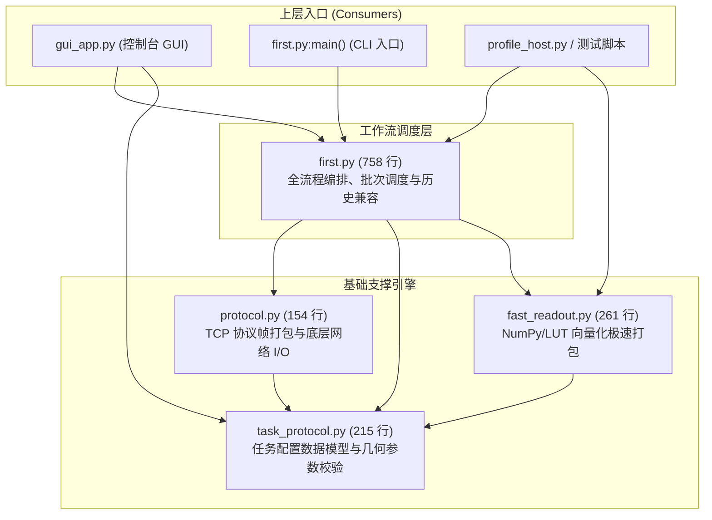

# 上位机客户端模块关系与重构调查报告（Client Module Map）

> **建立日期**：2026-09-11  
> **依据**：`docs/19-slimming-and-code-quality-plan.md` §3 B4（热清理调查专项）  
> **性质**：架构调研与依赖图谱，**本轮只做调查、不改动上位机代码**。  
> **约束**：上位机当前是驱动全链路闭环的唯一生产入口，在缺乏独立端到端自动化测试前严禁激进重构。

---

## 1. 四模块调用拓扑与层次架构

上位机 Python 客户端核心由四个演进阶段不同的模块构成：

---

## 2. 各模块唯一职责定义

| 模块 | 代码规模 | 唯一职责 | 核心对外接口/类 |
|---|---:|---|---|
| `task_protocol.py` | 215 行 | **纯数据模型与几何常量契约**。定义协议版本、帧尺寸、支持读长（SE150/250）、对齐字节算子、阈值换算及 CRC32 封包校验。无任何网络或 NumPy 依赖。 | `TaskSpec`, `TaskCaps`, `read_size_bytes()`, `default_score_min()`, `build_config_payload()` |
| `protocol.py` | 154 行 | **TCP 二进制帧编解码与传输原语**。管理自定义帧头（0xBEEF）、包类型（CONFIG/WM/BATCH/POST/RESULT）、网络统计吞吐采集与分包粘包处理。 | `NetStats`, `make_header()`, `make_packet()`, `sendall_count()`, `recv_exact()`, `recv_packet()`, `query_caps()` |
| `fast_readout.py` | 261 行 | **高性能向量化位平面打包引擎**。利用 NumPy 与 256 元素 ASCII 查表消除 Python 逐位循环，提供反向互补双链无损打包与流水线预分配缓冲区。 | `seq_to_read_bytes()`, `fast_pack_reads_batch()`, `fast_iter_read_batches()`, `fast_pack_watermark_bits()` |
| `first.py` | 758 行 | **工作流编排与历史兼容枢纽**。串联握手配置、水印流式预载、读段文件流式扫描、批次发送、结果接收与耗时度量，兼顾向后兼容性。 | `ClientConfig`, `ReadFileInfo`, `run_client()`, `analyze_reads_file()`, `format_metric_report()` |

---

## 3. 重复代码与职责重叠分析

通过静态符号扫描，四模块之间存在历史迭代留下的明显重叠：

### 3.1 序列打包逻辑的「双轨制」
- **`first.py` 中的旧实现**：
  保留了 `BASE2BITS = {'A': '00', 'C': '11', 'G': '10', 'T': '01', ...}` 字典及纯 Python 逐字符字符串拼接、位移打包逻辑（约 120 行），处理速度较慢（约 3.38 s/万条）。
- **`fast_readout.py` 中的现代实现**：
  引入 `LUT_HI`、`LUT_LO` 查表与向量化打包（约 0.11 s/万条，30.4x 提速）。
- **重叠现状**：
  `first.py` 在顶部 `from fast_readout import ... as fast_seq_to_read_bytes`，但内部依旧遗留了未完全摘除的旧函数及回退分支，接手者难以一眼确认生产路径究竟在走哪套逻辑。

### 3.2 水印与结果解包逻辑
- `first.py` 与 `fast_readout.py` 均定义了水印 8 字节对齐、结果展开（`RESULT_BYTES = 8100`）的局部常量与解包算子。
- 权威实现实际已收敛至 `fast_readout.py`，`first.py` 中的同名辅助函数多数已沦为死代码或局部被测包装。

### 3.3 常量定义的微小冗余
- `MAGIC`、`FRAME_READS`、`MAX_TOTAL_READS` 等核心参数在 `task_protocol.py` 与 `protocol.py` 中被交叉重导出，导致消费方（如 `gui_app.py`、`profile_host.py`）出现从不同模块 import 相同常量的混乱现象。

---

## 4. 消费方调用现状（全库 77 处提及分布）

扫描发现对 `first.py` 的引用主要分为三类：
1. **真实生产调用**：
   - `clients/python/gui_app.py`：完全依赖 `first.py` 的 `run_client`、`ClientConfig`、`analyze_reads_file`；
   - `tools/profile_host.py`：导入 `first.py` 评估端到端流程与分解基线；
   - `tools/run_multi_payload_regression.py`：调用 `first.py` 执行多数据集真实通信与打桩验证。
2. **测试用例覆盖**：
   - `clients/python/tests/test_client_core.py`：25 项单元测试覆盖了 `first.py`、`protocol.py` 与 `task_protocol.py`。
3. **文档与日志记载**：
   - 其余数十处散落在历史审计文档（如 `docs/archive/`）与压测日志说明中，记录历史演进过程。

---

## 5. 重构时机与安全退出路径建议

### 5.1 为什么本轮严禁改动
1. **生产入口独占性**：当前上位机代码是整套系统与 FPGA 硬件通信的唯一可用入口，一旦引入隐蔽回归，将直接瘫痪硬件联合调试；
2. **单源回归覆盖度不足**：目前客户端唯一的自动化单元测试为 `test_client_core.py`（25 项），虽然覆盖了配置与帧编解码，但对真实 TCP 大流量背压与网络异常中断的模拟并不完备；
3. **同源性保护**：按照 `AGENTS.md` 规则，改动上位机若涉及协议头或打包行为，会破坏已冻结的 G3 闭环记录。

### 5.2 下一阶段重构规划（待独立测试集建立后实施）
1. **第一步（消除双轨打包）**：将 `first.py` 中的纯 Python 旧打包函数标记 `@deprecated`，强制全部走 `fast_readout.py`；
2. **第二步（常数单一来源）**：将所有协议帧常量收敛至 `task_protocol.py`，`protocol.py` 仅保留底层网络封装；
3. **第三步（瘦身 `first.py`）**：将 `first.py` 从 758 行精简至 ~300 行纯编排控制器，彻底剥离重复的数据变换函数。
