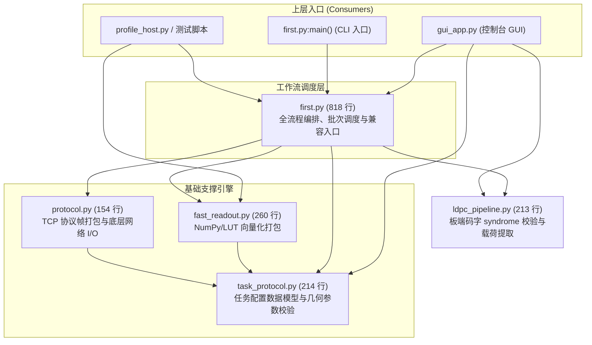

# 上位机客户端模块关系与重构调查报告（Client Module Map）

> **建立日期**：2026-09-11  
> **最近复核**：2026-10-14
> **依据**：`docs/archive/history/2026/pre-bkb220-handoff-2026-10-10/slimming-and-code-quality-plan.md` §3 B4（热清理调查专项）
> **性质**：架构调研与当前依赖图谱；职责说明按当前代码更新，不构成重构授权。
> **约束**：上位机当前是驱动全链路闭环的唯一生产入口，在缺乏独立端到端自动化测试前严禁激进重构。

---

## 1. 客户端模块调用拓扑与层次架构

客户端工作流核心由 `first.py`、`fast_readout.py`、`protocol.py`、`task_protocol.py` 和 `ldpc_pipeline.py` 构成；GUI 是工作流与板端结果校验的调用方：

---

## 2. 各模块唯一职责定义

| 模块 | 代码规模 | 唯一职责 | 核心对外接口/类 |
|---|---:|---|---|
| `task_protocol.py` | 214 行 | **纯数据模型与几何常量契约**。定义协议版本、帧尺寸、支持读长（SE150/250）、对齐字节算子、阈值换算及 CRC32 封包校验。无任何网络或 NumPy 依赖。 | `TaskSpec`, `TaskCaps`, `read_size_bytes()`, `default_score_min()`, `build_config_payload()` |
| `protocol.py` | 154 行 | **TCP 二进制帧编解码与传输原语**。管理自定义帧头（0xBEEF）、包类型（CONFIG/WM/BATCH/POST/RESULT）、网络统计吞吐采集与分包粘包处理。 | `NetStats`, `make_header()`, `make_packet()`, `sendall_count()`, `recv_exact()`, `recv_packet()`, `query_caps()` |
| `fast_readout.py` | 260 行 | **向量化位平面编码与打包实现**。利用 NumPy 与 ASCII 查表处理读段、水印及结果位流；`fast_iter_read_batches()` 当前会先加载本次输入并构造完整记录矩阵和发送缓冲，再逐批 yield。 | `seq_to_read_bytes()`, `batch_seqs_to_records()`, `fast_iter_read_batches()`, `fast_pack_watermark_bits()` |
| `first.py` | 818 行 | **网络工作流编排与兼容入口**。串联握手配置、水印发送、读段批次发送、结果接收与耗时度量；`iter_read_batches()` 委托给 `fast_readout.fast_iter_read_batches()`，单条编码兼容入口也委托给向量化实现。 | `ClientConfig`, `ReadFileInfo`, `run_client()`, `iter_read_batches()`, `analyze_reads_file()` |
| `ldpc_pipeline.py` | 213 行 | **板端结果校验与载荷提取**。解包并解交织板端码字，校验 syndrome；有非零校验行时抛出 `BoardCodeRejected`，全零时提取信息位和载荷。模块不提供 PC 端译码或回退。 | `BoardCodeRejected`, `verify_board_result()`, `syndrome_failures()` |

---

## 3. 重复代码与职责重叠分析

通过静态符号扫描，客户端保留了工作流兼容入口；当前编码实现与验证职责如下：

### 3.1 读段编码与批次生成
- `first.py::iter_read_batches()` 直接委托给 `fast_readout.py::fast_iter_read_batches()`；`first.py::seq_to_read_bytes()` 也委托给 `fast_readout.py::seq_to_read_bytes()`。
- 当前批次生成函数会先读取本次源读段、生成编码矩阵并构造 `send_total` 大小的缓冲，再按 `batch_size` 产出负载。因此接口按批次交付，但生成首批前已物化本次输入和发送缓冲。
- `first.py` 中仍保留 `BASE2BITS` 等兼容/历史符号；它们不构成上述批次路径的纯 Python 回退实现。

### 3.2 水印、结果与板端校验
- `first.py` 的 `pack_watermark_bits()` 与结果接收路径分别委托给 `fast_readout.py` 的打包和解包实现；工作流模块保留便于调用的入口。
- `ldpc_pipeline.py` 只对 FPGA 回传码字做 syndrome 校验和信息位/载荷提取。`native_ldpc.hard_decode` 留给离线工具，不是客户端的译码回退路径。

### 3.3 常量定义的微小冗余
- `MAGIC`、`FRAME_READS`、`MAX_TOTAL_READS` 等核心参数在 `task_protocol.py` 与 `protocol.py` 中被交叉重导出，导致消费方（如 `gui_app.py`、`profile_host.py`）出现从不同模块 import 相同常量的混乱现象。

---

## 4. 消费方调用现状

扫描发现对 `first.py` 的引用主要分为三类：
1. **真实生产调用**：
   - `clients/python/gui_app.py`：调用 `first.py` 的 `run_client`、`ClientConfig`、`analyze_reads_file`，并直接调用 `ldpc_pipeline.py` 校验板端回传；
   - `first.py:main()`：CLI 完成板端结果接收后调用 `ldpc_pipeline.py` 校验和提取载荷；
   - `tools/profile_host.py`：导入 `first.py` 评估端到端流程与分解基线；
   - `tools/run_multi_payload_regression.py`：调用 `first.py` 执行多数据集真实通信与打桩验证。
2. **测试用例覆盖**：
   - `tools/test_client.sh`：发现客户端 unittest；当前入口下限为 28 项，收集总数包含跳过项，因此不能单独据此推断用例均已执行。
3. **文档与日志记载**：
   - 其余数十处散落在历史审计文档（如 `docs/archive/`）与压测日志说明中，记录历史演进过程。

---

## 5. 重构时机与安全退出路径建议

### 5.1 为什么本轮严禁改动
1. **生产入口独占性**：当前上位机代码是整套系统与 FPGA 硬件通信的唯一可用入口，一旦引入隐蔽回归，将直接瘫痪硬件联合调试；
2. **单源回归覆盖度不足**：客户端 unittest 覆盖了配置与帧编解码，但对真实 TCP 大流量背压与网络异常中断的模拟并不完备；测试收集数也包含跳过项；
3. **同源性保护**：按照 `AGENTS.md` 规则，改动上位机若涉及协议头或打包行为，会破坏已冻结的 G3 闭环记录。

### 5.2 下一阶段重构规划（待独立测试集建立后实施）
1. `first.py` 的批次入口和单条编码兼容入口当前已委托给 `fast_readout.py`；后续清理遗留符号前先核对其兼容调用范围，不再把切换生产打包路径列作待办；
2. **第二步（常数单一来源）**：将所有协议帧常量收敛至 `task_protocol.py`，`protocol.py` 仅保留底层网络封装；
3. **第三步（瘦身 `first.py`）**：评估是否将当前 818 行工作流模块缩减为纯编排控制器，并剥离已委托给专用模块的数据变换入口。
