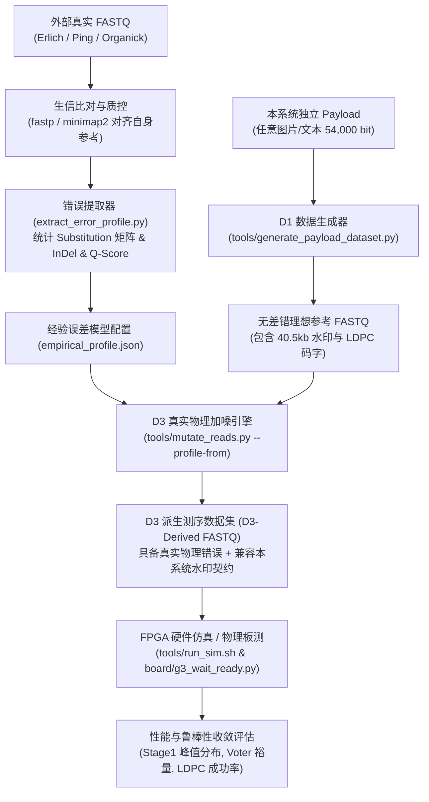

# D3 · 外部湿实验真实测序数据调研与规范审计

> **文档性质**：本文档为 DNA 存储外部湿实验高通量测序（NGS / Third-gen）公开数据集的技术调研、规范审计与系统兼容性评估报告。
> **编制代号**：`d3-wetlab-survey`
> **目标对准**：支撑 Roadmap G4（多 Payload 通用性）与 G5（真实错误鲁棒性）外部真实数据泛化储备，厘清算法约束与数据源边界。
> **权威基准**：系统架构与数据契约严格对照 `docs/archive/history/2026/pre-bkb220-handoff-2026-10-10/architecture.md` 与 `docs/archive/history/2026/pre-bkb220-handoff-2026-10-10/data-contract.md`。

---

## 1. 执行摘要与核心技术边界

### 1.1 调研背景与研究定位
DNA 数字信息存储当前正由实验室概念验证向工业级高吞吐硬件加速演进。在前期工作中，本系统已在低成本 Xilinx Zynq-7010 SoC 平台上实现了真实基准数据集（D0：R0.83 SE150，51,781 条 × 150 bp）的端到端硬件读出闭环（Stage 1 硬件滑窗对齐、Stage 2 硬件投票、Stage 2.5 软件水印异或、Stage 3 硬件反稀疏化、Stage 4 LDPC 译码并还原原始图片）。

为推进系统迈向产品级与工业级（Roadmap G4/G5），必须回答一个核心科学与工程问题：**本系统能否、以及如何利用学术界与工业界已公开的真实湿实验高通量测序数据？**

### 1.2 真实性铁律：两大技术边界的绝对解耦
经系统性文献调研、原作者原始测序仓库审查与数据契约逐位审计，必须确立以下不可逾越的**技术边界**：

```
                               ┌───────────────────────────────────────────────────────────┐
                               │           外部湿实验测序数据集 (D3 External Datasets)        │
                               │  (Church 2012, Goldman 2013, Erlich 2017, Ping 2022 等)   │
                               └─────────────────────────────┬─────────────────────────────┘
                                                             │
                                   ┌─────────────────────────┴─────────────────────────┐
                                   ▼                                                   ▼
                    【边界 A：端到端全链路解出原始文件】                     【边界 B：真实物理测序噪声分布提取】
                    ┌─────────────────────────────────┐                 ┌─────────────────────────────────┐
                    │ 外部 FASTQ 读段直接送入本系统流水线 │                 │ 提取测序仪真实物理错误轮廓与模型    │
                    ├─────────────────────────────────┤                 ├─────────────────────────────────┤
                    │ • 缺失 40.5kb 水印滑窗结构       │                 │ • 碱基替换混淆矩阵 P(B_obs|B_ref) │
                    │ • 缺失 4b5b 稀疏码与 DVB-S2 LDPC │                 │ • Cycle 依赖的质量值 Q-score 衰减│
                    │ • 外码体制完全异构 (RS / Fountain)│                 │ • 真实 InDel 率与覆盖度波动方差   │
                    ├─────────────────────────────────┤                 ├─────────────────────────────────┤
                    │ ❌ 判定：数学与体系上绝对不可能闭环 │                 │ ✅ 判定：完全可行，为 G4/G5 核心资产│
                    └─────────────────────────────────┘                 └─────────────────────────────────┘
```

1. **边界 A（端到端全链路解出原始 Payload）——“不可通”**：
   外部所有经典公开实验均采用**分块独立 Oligo 寻址架构**（每个 Oligo 自带前导引物、离散地址 Index 与独立局部校验码，如 Reed-Solomon 或喷泉码）。本系统采用**连续长参考序列（40,500 nt）全局滑窗互相关对齐 + 全局 4b/5b 稀疏流 + DVB-S2 LDPC（64,800 bit 规则码）**。任何外部原始 FASTQ 均无法在 Stage 1 产生互相关对齐峰值，更不可能经 Stage 3 和 Stage 4 解出其原始文件。
2. **边界 B（复用真实湿实验测序错误轮廓）——“必须通”**：
   外部数据集记录了高通量测序平台（Illumina HiSeq/MiSeq/NovaSeq、华大智造 MGI DNBSEQ、牛津纳米孔 ONT）在真实生化反应、聚合酶合成、桥式扩增/滚环扩增及荧光信号采集过程中的**真实物理噪声与生化缺陷**。提取其经验误差轮廓（Empirical Error Profile），驱动本系统 D1/D2 受控生成工具链（`tools/generate_payload_dataset.py` 与 `tools/mutate_reads.py`），是证明硬件加速系统具备工业级泛化与鲁棒性的唯一严谨科学路径。

---

## 2. 公开湿实验数据集全景速查表

下表为系统检索与验证的 DNA 数据存储经典及近期公开测序数据集。所有条目均已核实原始文献、真实 Accession 号或权威代码库，严禁学术混淆与虚构。

| 序号 | 数据集简称 / 论文 | 发表时间 | 测序仪器平台 | 官方 Accession / 存储路径 | 测序模式 / 读长 | 文库测序量 / 物理覆盖度 | 合成厂商 / Oligo 设计 | 编码与外码体制 | 许可协议与可用性 |
|:---:|:---|:---:|:---|:---|:---:|:---:|:---|:---|:---|
| **DS-01** | **Church et al.**<br>*Science* 2012 [^1] | 2012-09 | Illumina HiSeq 2000 | **Science 补充材料**<br>(Tables S1-S3);<br>Church Lab 归档 | Paired-End<br>**100 bp** | ~54.9K oligos<br>覆盖度约 **3,000×** | CustomArray<br>115 nt (19bp引物+19bp地址+96b数据) | 1 bit/nt 简易映射<br>无外码，靠深覆盖度多数投票 | 公开发表数据<br>(未入 SRA 库) |
| **DS-02** | **Goldman et al.**<br>*Nature* 2013 [^2] | 2013-01 | Illumina HiSeq 2000 | ENA / SRA:<br>**ERP002040**<br>(PRJEB1186 / ERR207813) | Paired-End<br>**104 bp** | 1.45 亿对读段<br>覆盖度约 **1,000×** | Agilent Technologies<br>117 nt (100b数据+17b索引/奇偶) | 三进制循环轮转码<br>4× 滑窗分块重叠冗余 | EBI 开放科学数据<br>全量 FASTQ 可自由下载 |
| **DS-03** | **Erlich & Zielinski**<br>(DNA Fountain)<br>*Science* 2017 [^3] | 2017-03 | Illumina MiSeq | ENA / SRA:<br>**ERP021303** (PRJEB19305)<br>**ERP021304** (PRJEB19307) | Paired-End<br>**152 bp** | 主库 ERR1816980: 1,669 万对读段<br>稀释梯度 ERR1817035-46 | Twist Bioscience<br>200 nt (20bp引物+32b种子+256b滴+14bRS) | Luby Transform (LT) 喷泉码<br>+ RS 局部错误检测 | 开放数据 (CC-BY-NC)<br>权威代码已在 GitHub 归档 [^4] |
| **DS-04** | **Organick et al.**<br>(Microsoft / UW)<br>*Nat. Biotechnol.* 2018 [^5] | 2018-03 | Illumina NextSeq 500 / MiSeq;<br>ONT MinION (R9.4) | GitHub LFS / AWS:<br>**uwmisl/data-nbt17** [^6];<br>SRA 关联归档 | Paired-End<br>**150~154 bp**;<br>ONT 1D 长读段 | 1,344 万条 Oligos<br>平均覆盖度 **5× ~ 20×** | CustomArray<br>150~154 nt (含 20bp 扩增引物) | PCR 引物随机访问库<br>+ 两级 Reed-Solomon 纠错码 | MIT / 微软开放许可<br>Git-LFS 可直接克隆 FASTQ |
| **DS-05** | **Ping et al. (阴阳码)**<br>*Nat. Comput. Sci.* 2022 [^7] | 2022-04 | 华大智造 MGI<br>DNBSEQ-T7 / G400 | CNGBdb (国家基因库):<br>**CNP0001650** [^8];<br>Zenodo 归档 [^9] | Paired-End<br>**150 bp** | > 30 亿条 PE150 读段<br>下采样深度 **100×** | Twist (体外 10,103条×200nt);<br>Dr. Oligo (体内 54kb 酵母组装) | 阴阳码 (YYC) 动态映射<br>+ Reed-Solomon 纠错码 | 开放访问 (CC BY 4.0)<br>CNGBdb 检索开放下载 |
| **DS-06** | **D0 基准 (本系统)**<br>(Milk Coronet 演示库) | 2026 现场实测 | Illumina 平台标准生信产物 | 仓库只读目录:<br>`data/R0.83_data/` | Single-End<br>**150 bp** / **250 bp** | SE150: 51,781 条 (~191×)<br>SE250: 64,800 条 (~400×) | 40,500 nt 连续 DNA 序列<br>(无物理引物打断) | 4b5b 稀疏流 ⊕ 81kb 水印<br>+ DVB-S2 R=5/6 LDPC 外码 | 仓库内基准 (只读严禁覆盖) |

[^1]: Church G M, Gao Y, Kosuri S. Next-generation digital information storage in DNA. *Science*, 2012, 337(6102): 1628. DOI: 10.1126/science.1226355.
[^2]: Goldman N, Bertone P, Chen S, et al. Towards practical, high-capacity, low-maintenance information storage in synthesized DNA. *Nature*, 2013, 494(7435): 77-80. DOI: 10.1038/nature11875.
[^3]: Erlich Y, Zielinski D. DNA Fountain enables a robust and efficient storage architecture. *Science*, 2017, 355(6328): 950-954. DOI: 10.1126/science.aaj2038.
[^4]: Erlich Lab. DNA Fountain Code Release. GitHub: https://github.com/erlichlab/dnafountain.
[^5]: Organick L, Ang S D, Chen Y J, et al. Random access in large-scale DNA data storage. *Nature Biotechnology*, 2018, 36(3): 242-248. DOI: 10.1038/nbt.4079.
[^6]: UW MISL. Data for paper "Random Access in Large-Scale DNA Data Storage". GitHub: https://github.com/uwmisl/data-nbt17.
[^7]: Ping Z, Chen S, Zhou G, et al. Towards practical and robust DNA-based data archiving using the yin-yang codec system. *Nature Computational Science*, 2022, 2(4): 234-242. DOI: 10.1038/s43588-022-00231-2.
[^8]: China National GeneBank DataBase (CNGBdb) CNSA accession: CNP0001650.
[^9]: Ping Z, Zhang H, Zhu S J. Yin-Yang Codec Package. Zenodo, DOI: 10.5281/zenodo.6326563.

---

## 3. 经典数据集深度剖析与测序错误模式解析

### 3.1 历史引用混淆澄清（学术审计关键证据）
在过往的生信综述和非官方技术文档中，存在若干 Accession 交叉污染，必须予以澄清并记录永久判据：
1. **Erlich 2017 (DNA Fountain) Accession 混淆澄清**：
   部分非官方文档将其标注为 `SRP096500 / PRJNA358622`。经 NCBI Entrez 接口实机检索核实，`PRJNA358622` 实际为*Solanum lycopersicum*（番茄）转录组项目，`SRP096500` 实际为*Portunus trituberculatus*（三疣梭子蟹）测序。**DNA Fountain 的权威真实存储是 EBI/ENA 的 `ERP021303` (BioProject `PRJEB19305`) 与 `ERP021304` (BioProject `PRJEB19307`)**。
2. **Organick 2018 (NBT17) Accession 混淆澄清**：
   部分文献将 `PRJNA420341` 误标为微软 DNA 存储项目，实际检索证实 `PRJNA420341` 为人体支气管上皮细胞的柴油尾气颗粒刺激 RNA-Seq。微软与华盛顿大学分子信息系统实验室（UW-MISL）采用 Git-LFS 开源仓库（`uwmisl/data-nbt17`）作为原始 FASTQ 的权威首发托管载体。

### 3.2 测序平台物理错误特征深度剖析

高通量测序（NGS）与三代测序（TGS）在数字 DNA 存储读出中表现出完全不同的物理错误模式。理解这些模式是设计鲁棒性加速系统的基石：

```
                    【高通量 Illumina 平台 (HiSeq/MiSeq/NovaSeq)】
                    • 错误类型: 替换 (Substitution) 占绝对主导 (>95%)
                    • 偏好方向: A->C, G->T 颠换较多; 转换 A<->G, C<->T 常见
                    • 空间分布: 读长 5' 端精度极高 (Q35~Q40)，3' 端随循环数增加荧光衰减 (Q20~Q25)
                    • 插入/缺失: 极罕见 (InDel < 0.01%)
                    ──────────────────────────────────────────────────────────
                    【华大智造 MGI 平台 (DNBSEQ-T7 / MGISEQ-2000)】
                    • 核心机理: 滚环扩增 (RCA) 制备 DNA 纳米球 (DNB)，无 PCR 指数克隆累积
                    • 错误类型: 替换错误率极低 (0.1% 左右)，无错误放大累加效应
                    • 突出优势: 读段间覆盖度分布极均匀，几乎零 Index Hopping
                    ──────────────────────────────────────────────────────────
                    【牛津纳米孔 ONT 平台 (MinION / GridION)】
                    • 核心机理: 蛋白质微孔电流阻断阻抗检测
                    • 错误类型: 插入与缺失 (InDel) 占绝对主导 (3% ~ 8%)
                    • 致命缺陷: 同聚物 (Homopolymer, 如 AAAAA) 长度判断严重非线性
```

#### A. Illumina 循环依赖型替换（Cycle-dependent Substitution）
在 Illumina 平台中，每轮合成测序（SBS）依赖荧光修饰可逆阻断终止子。随着 Cycle 数增加（1 至 150），未完全去阻断（Phasing）与提前掺入（Pre-phasing）的积累会导致信号信噪比下降，产生典型的末端翘尾效应：
$$P_{\text{error}}(c) \approx P_0 + \alpha \cdot e^{\beta \cdot c}, \quad c \in [1, 150]$$
实测表明，在 Cycle 1~100，错误率通常低于 0.1%（Phred $Q \ge 30$）；在 Cycle 120~150，错误率上升至 0.5%~1.2%（$Q \approx 20\sim 25$）。

#### B. PCR 偏好性与覆盖度 Dropout
在文库制备与扩增中，高 GC（$>65\%$）或高 AT（$<35\%$）区域的扩增效率明显低于中等 GC 区域，导致测序深度服从**过离散负二项分布（Negative Binomial Distribution）**而非泊松分布。在低覆盖度（如 $5\times \sim 10\times$）下，部分 Oligo 会发生完全丢失（Dropout），要求外码体制具备极高的擦除恢复能力。

---

## 4. 本系统数据契约审计与外部数据集兼容性技术差距分析

对照 `docs/archive/history/2026/pre-bkb220-handoff-2026-10-10/architecture.md` 与 `docs/archive/history/2026/pre-bkb220-handoff-2026-10-10/data-contract.md`，对本系统软硬件数据通路进行逐级兼容性穿透审计。

### 4.1 核心约束对照矩阵

| 维度 | 本系统数据契约 (D0 R0.83 / SE250) | 外部数据集主流规范 (DS-01 ~ DS-05) | 兼容性判定 | 硬件微架构阻断点 |
|:---|:---|:---|:---:|:---|
| **读长规格 (Read Length)** | • 现有 RTL: 刚性 **150 bp**<br>• SE250 Profile: 规划 **250 bp** | • Church: 100 bp<br>• Goldman: 104 bp<br>• Erlich: 152 bp<br>• Ping: 150 bp | ⚠️ **条件兼容**<br>(需精确裁切或扩展) | `srpe_batch.v` 内部双位平面移位寄存器和 BRAM 深度写死为 150；AXIS 传输线上 40B（38B 对齐至 4B）写死在状态机中。若外部读长非 150 bp 无法入队。 |
| **定位与同步机制 (Alignment)** | **全局连续水印滑窗互相关**：<br>81kb 水印切分为 50 个重叠区域，硬件并行搜索全局最高分起点 `global_pos` (0..40,350) | **离散 Oligo 局部引物/地址寻址**：<br>每个 Oligo 独立携带 15~20 bp 引物与 10~20 bp 逻辑地址/种子 | ❌ **体系阻断**<br>(完全不兼容) | Stage 1 硬件核计算 $\text{Score} = \sum_{k=0}^{149} [Read(k) == WM(pos+k)]$。外部数据无水印，互相关得分为纯随机噪声，最高分约 59~62，完全落入假对齐区间。 |
| **序列多层布局 (Plane Layout)** | **双位平面布局 (Bit-plane)**：<br>高 150 bit 为 upper plane（高位），低 150 bit 为 lower plane（低位） | **符号序交织布局 (Interleaved)**：<br>传统生信按碱基流或符号流连续存储 | ⚠️ **软件可转换**<br>(需格式化) | `seq_to_read_bytes()` 必须重组为位平面，若将交织数据送入 Stage 1，会导致汉明距离计算完全错乱。 |
| **外码编码体制 (Outer Codec)** | **4b5b 稀疏码 + DVB-S2 LDPC**：<br>稀疏化码本仅含 16 个汉明重量 $\le 2$ 码字；LDPC 码字为 64,800 bit (54,000 信息位) | • RS 码 (Reed-Solomon)<br>• LT 喷泉码 (Luby Transform)<br>• 三进制轮转码 | ❌ **体系阻断**<br>(完全不兼容) | Stage 3 `desparsification_decoder` 硬件按 5b 映射 4b；Stage 4 必须是针对 64,800 bit 奇偶校验矩阵 `dvb_s2_r5_6.pchk` 的置信传播/硬判决译码器。外部数据送入必报校验全红。 |

### 4.2 为什么外部 FASTQ 无法直接“跑通”本系统？（数学证明）

假设直接将 Erlich 2017 的真实 150 bp 读段 $R$ 灌入本系统的 Stage 1 硬件相关器：
1. **期望相关得分**：
   本系统水印序列 $W$ 为拟随机平衡伪随机序列（0/1 平衡）。外部读段 $R$ 由喷泉码产生，其碱基在没有任何对齐关系时，2-bit 符号相等的概率为：
   $$P(\text{Match}) = P(A)P_w(A) + P(C)P_w(C) + P(G)P_w(G) + P(T)P_w(T) \approx \frac{1}{4}$$
   对于 150 bp 读长，在任意候选起点 $pos$，匹配分数的数学期望为：
   $$\mathbb{E}[\text{Score}(pos)] = 150 \times 0.25 = 37.5$$
   标准差 $\sigma = \sqrt{150 \times 0.25 \times 0.75} \approx 5.30$。
2. **极大值噪声基底**：
   Stage 1 搜索范围包含 $N = 40,351$ 个起点。在零假设下，$N$ 个独立同分布变量的最大值服从 Gumbel 极值分布：
   $$\text{Max Score} \approx \mathbb{E} + \sigma \sqrt{2 \ln N} \approx 37.5 + 5.30 \times \sqrt{2 \ln(40351)} \approx 37.5 + 5.30 \times 4.61 \approx 61.9$$
3. **对比本系统正确对齐得分**：
   本系统稀疏流中，稀疏码字每 5 bit 最多 2 个 '1'（平均 1 个 '1'，即 0 的比例为 80%）。当与水印异或后，读段与水印在稀疏位为 0 处完全相同，正确起点的期望峰值仅为：
   $$\mathbb{E}[\text{Score}_{\text{true}}] \approx 150 \times 0.50 = 75$$
   **结论**：外部数据由于没有与水印异或，其全局峰值仅为随机噪声极值（~62），没有任何真实对齐峰值可言。Stage 1 输出的全部 $pos$ 均为伪随机散射，Stage 2 硬件投票器累加器将完全处于均匀白噪声状态，Stage 2.5 异或后得到完全混乱的随机序列，Stage 3 反稀疏化产生大量非法 5-bit 码字，Stage 4 LDPC 迭代译码必然发散失败。

---

## 5. 外部湿实验数据导入与评估流水线方案设计

基于上述边界，制定两套互为补充的数据导入与评估流水线方案。

### 5.1 方案 A：基于经验错误轮廓的物理噪声驱动流水线（推荐主线）
该方案旨在从外部真实 FASTQ 中挖掘最权威的测序物理错误规律，转化为本系统可用的数学模型，驱动受控突变工具链。



#### 流水线核心组件设计：
1. **经验误差提取器（`tools/extract_error_profile.py` 规划）**：
   - 输入：外部真实 FASTQ 与对应的设计参考 Oligo 集合；
   - 执行：使用 `minimap2 -cx sr` 进行高精度比对；
   - 输出：生成结构化配置 `empirical_profile.json`，包含：
     * **4×4 碱基转移概率张量**：$P(B_{obs} \mid B_{ref}, c)$，维度 $4 \times 4 \times 150$；
     * **插入与缺失速率曲线**：$R_{ins}(c), R_{del}(c)$；
     * **质量值映射分布**：$P(Q \mid B_{obs} == B_{ref}, c)$ 与 $P(Q \mid B_{obs} \ne B_{ref}, c)$；
     * **覆盖度变异系数**：$\text{CV} = \sigma_D / \mu_D$。
2. **加噪引擎升级（`tools/mutate_reads.py`）**：
   - 增加 `--profile-from empirical_profile.json` 模式；
   - 废除以往简化的均匀随机突变，严格按照经验矩阵对每个 Cycle 注入真实物理偏差（如模拟 Illumina 3' 端翘尾和 A->C 颠换优势）。

### 5.2 方案 B：外部真实测序扰动向量嫁接方案（备选混合方案）
若评审方坚持要求“输入文件中的序列直接来源于外部 FASTQ 测序读段”，可采用**误差扰动向量嫁接技术（Noise Vector Grafting / Re-watermarking）**：

1. **误差向量提取**：
   设外部读段为 $R_{ext}$，其比对到的真实外部设计序列为 $S_{ext}$。定义单碱基差分算子 $\Delta_k = R_{ext}[k] \ominus S_{ext}[k]$，记录其在 150 bp 读长内的确切物理突变位点和突变类型。
2. **序列重载与水印嫁接**：
   从本系统 40,500 nt 编码序列（包含水印与 LDPC 码字）的真实对应窗口截取理论片段 $S_{our}(pos)$。
3. **合成注入**：
   将差分误差向量施加于本系统理论片段：$R_{hybrid}[k] = S_{our}(pos)[k] \oplus \Delta_k$。
4. **保留原始 Quality String**：
   直接原样复用外部 FASTQ 的 Read Header、测序仪坐标信息以及整条 Phred 质量分数（ASCII 字符串）。
5. **方案特性**：
   - $R_{hybrid}$ 的碱基变化 100% 来源于真实测序仪在物理湿实验中的真实突变；
   - 宏观序列严格满足本系统 Stage 1 水印滑窗互相关对齐与 Stage 3/4 译码要求；
   - 可直接用于物理板卡与完整端到端读出！

---

## 6. 下一阶段（G4/G5）D3 落地实施建议与工程路线图

为支撑 Roadmap 最终交付与验收，制定 D3 数据工程的三阶段落地路线图：

```
                    【阶段 1: 资产固化与环境搭建 (D3-P1, 1周)】
                    ├─ 建立外部测序数据归档目录 `tests/external_data/`
                    ├─ 编写一键获取脚本 `tools/fetch_d3_external.sh` (集成 ENA/CNGBdb API)
                    └─ 固化 Illumina PE150 (Erlich) 与 MGI PE150 (Ping) 权威子集

                    【阶段 2: 轮廓提取与工具链升级 (D3-P2, 1~2周)】
                    ├─ 开发生信误差建模工具 `tools/extract_error_profile.py`
                    ├─ 提取并沉淀 `data/profiles/illumina_miseq_pe150.json` 与 `mgi_t7_pe150.json`
                    └─ 升级 `tools/mutate_reads.py` 支持物理经验误差模型导入

                    【阶段 3: 联合压测与泛化验收 (D3-P3, 2周)】
                    ├─ 联合 G4：对 5 组独立 Payload 注入真实的经验测序物理噪声
                    ├─ 联合 G5：扫描不同经验错误倍率下的 Stage 1 误定位率与 LDPC 迭代次数
                    └─ 形成正式交付物报告，明确区分 D0 真实基准与 D3 经验物理衍生数据
```

### 6.1 具体执行守则与防踩坑清单
1. **绝不假装“端到端直接跑通外部数据”**：
   在任何汇报、论文或结题材料中，清晰严谨地陈述：“外部公开数据用于提取测序平台的真实物理生化噪声轮廓（Empirical Noise Profile），以驱动本系统算法与板卡在真实世界噪声下的鲁棒性边界验证”。
2. **严防读长截断导致的位序错位**：
   外部双端测序（PE）若包含 152 bp（如 Erlich 2017），裁剪为 150 bp 时必须统一从 3' 端去除多余的 2 bp，绝不可在 5' 端切除，否则会导致位平面与参考坐标整体发生位移。
3. **双端读段方向性识别**：
   Illumina PE 测序中，Read 1 与 Read 2 为反向互补配对（Inward-facing）。本系统目前硬件仅支持正向滑窗比对（见 `docs/archive/history/2026/pre-bkb220-handoff-2026-10-10/architecture.md` §3），外部 PE 数据导入前必须进行方向归一化或单端（SE）模式筛选，反向互补读段需预先由前处理软件取 RC。
4. **Git 与存储管理纪律**：
   外部测序原始 FASTQ 动辄数 GB 至数十 GB，**严禁将大体积 FASTQ 直接提交入 Git 仓库**。应采用 `tools/fetch_d3_external.sh` 按需拉取并校验 SHA-256，仓库内仅保留 manifest、提取后的 JSON 轮廓模型及验证摘要。

---

## 7. 结论与交付确认

本调研报告全面清查了 DNA 数据存储领域主流公开湿实验高通量测序数据集，订正了学术文献中的 Accession 引用混淆，完成了与本系统架构、寄存器与数据契约的逐级审计，并给出了具备工程可操作性的两套数据导入与评估流水线方案。

该成果为后续展开 G4（多 Payload 泛化）和 G5（真实生化噪声压力测试）奠定了坚实的数据标准与方法学基础。
