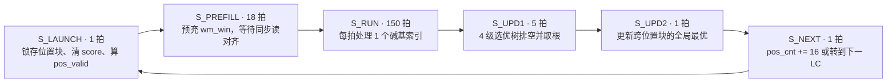

> 脱敏副本，原件 `20261013T073952Z-170708f420/{prompt.txt,answer.md}`。本机绝对路径、邮箱、凭据形模式及非白名单私网 IP 已替换；除脱敏与换行规范化外保留原文。

## 位置步时序流程

P16 活跃路径是 `Dna_accelerator_core_v1_0` 的 `g_stage1_pway`，实例化 `srpe_batch_pway`；Vivado 报告的层级也确认了这一点。[顶层选择逻辑](<<仓库根目录>/hw/ip/Dna_accelerator_core_1_0/hdl/Dna_accelerator_core_v1_0.v:399>) [P16 利用率报告](<<仓库根目录>/hw/build/bkb220-p16-enet0-100mhz-20261012T144141Z-board-migrate/reports/util.rpt:31>)

一块位置从 `S_LAUNCH` 到 `S_NEXT` 共 **176 个 PL 时钟**：`S_PREFILL` 的计数从 0 到 17，共 18 拍；`S_RUN` 的 `run_cnt` 从 0 到 149，共 150 拍；P16 的 `P_LOG=4`，`S_UPD1` 等 4 拍后再用第 5 拍锁存树根。相关计数与转移在 [`srpe_batch_pway.v`](<<仓库根目录>/hw/ip/Dna_accelerator_core_1_0/hdl/srpe_batch_pway.v:389>)。

数据对齐如下：

- `plane_lo/plane_hi[a_addr]` 同步读出 64 条读段的一个碱基平面，结果进入 `a_lo_q/a_hi_q`。
- `wm_bram` 经 `wm_rd_addr_q`、`wm_sym_q` 后进入 `wm_win`；同步读延迟由 `S_PREFILL` 吸收。它构成启动开销，热循环中每拍仍能推进一个碱基索引。[读端口与水印读流水](<<仓库根目录>/hw/ip/Dna_accelerator_core_1_0/hdl/srpe_batch_pway.v:95>) [水印读寄存器](<<仓库根目录>/hw/ip/Dna_accelerator_core_1_0/hdl/srpe_batch_pway.v:245>)
- 每个 `S_RUN` 时钟，`match_mask[p][t]` 对 16 个候选起点、64 条读段做符号比较，并更新相应的 `score[p][t]`。这拍处理 **16×64=1,024 条读段—位置累加通道**；150 拍覆盖每条读段的 150 个碱基。[匹配与累加](<<仓库根目录>/hw/ip/Dna_accelerator_core_1_0/hdl/srpe_batch_pway.v:430>)
- 每块的局部最优经选优树进入 `stage1_score/stage1_pos`，再由 `S_UPD2` 与跨块的 `best_sc` 比较。全部位置搜索结束后才进入 `S_EMIT` 输出记录。

握手不在 `S_RUN` 内：输入的 `cw_req/cw_valid` 在装载阶段交互；`res_full` 只会阻止结果发射；`s2mm_pack64` 以 `m_vld && m_rdy` 推进输出 beat。[输入 FIFO 对齐](<<仓库根目录>/hw/ip/Dna_accelerator_core_1_0/hdl/Dna_accelerator_core_v1_0.v:273>) [打包器握手](<<仓库根目录>/hw/ip/Dna_accelerator_core_1_0/hdl/s2mm_pack64.v:66>)

## 3 周期的来源（含证据）

代码里的 `pos_cnt` 每块前进 16，`pos_valid[p]` 又以 `pos_cnt+p <= STRIDE` 判有效。因此 `STRIDE=807` 时，起点是 **0…807，共 808 个/区域**；每区 51 块，50 区共 **2,550 块/记录**，而不是按 `40,350/16` 得到的约 2,522 块。[有效位置与步进](<<仓库根目录>/hw/ip/Dna_accelerator_core_1_0/hdl/srpe_batch_pway.v:392>) [步进边界](<<仓库根目录>/hw/ip/Dna_accelerator_core_1_0/hdl/srpe_batch_pway.v:484>)

所以给定的 7,500 周期/记录按代码的块数归一化为 **2.94 周期/记录块**。这不是 RTL 状态机每 2.94 拍启动一个块：硬件每块实际占 176 拍，但一次同时处理 **64 条记录**，摊到每条记录就是 `176/64 = 2.75` 周期/块。纯搜索循环共 `2,550×176 = 448,800` 拍/64 条记录，即 7,012.5 拍/记录；这能解释“约 3”的数量级，实测与代码计数仍不是同一个边界的精确逐拍分解。

A–E 的判定：

- **C 是主要工作形态**：每个位置块要按 `READ_BPS=150` 顺序累计 150 个碱基；累加器每拍更新一次，没有停顿气泡。
- **E 对吞吐单位的解释成立**：一个位置块是每条记录的 16 个候选起点，而且同时覆盖 BATCH 的 64 条记录；一个 `S_RUN` 拍推进一个碱基索引，不是完成一个位置块。
- **A 不是约 3 的来源**：选优树确有 4 级寄存流水和排空等待，但只占每块 5 拍。当前最差时序路径是 `pos_valid_reg[8]` 到选优树节点寄存器，数据路径 9.477 ns，其中布线 8.011 ns、逻辑 1.466 ns；这是布线/扇出风险，不是 150 拍循环的来源。[P16 时序报告](<<仓库根目录>/hw/build/bkb220-p16-enet0-100mhz-20261012T144141Z-board-migrate/reports/timing.rpt:240>)
- **B 只解释预充填**：BRAM 同步读带来启动对齐，不是热循环中的端口冲突停顿。
- **D 不是热循环来源**：`S_RUN` 不等待 `cw_valid`、`res_full` 或 AXIS `TREADY`。

补充边界：若机械累加源码中的 `S_LOAD_R`（每条读段 150×3 拍）、搜索循环和 `S_EMIT`（约每条 150×3 拍加最终写入），完整状态机周期估计约 7.9k 拍/记录，略高于给定的 7.5k PL 摊销数。我不重复测量或否定给定板测值；这说明板测反解值不能直接当成这份 RTL 的逐状态周期追踪。本次只读分析无法给出两种计时边界之间的精确归因。

版本核对也影响结论：磁盘上的 `srpe_batch.v` 是 2-way 源码；当前变体清单打包的是 `srpe_batch_4way.v` 与 `srpe_batch_pway.v`。[变体清单](<<仓库根目录>/hw/ip/PACKAGED_VARIANTS.txt:12>) `Dna_accelerator_core_4way` 是独立的旧 4-way wrapper，不是当前 P16 顶层选中的路径。[4-way wrapper 实例](<<仓库根目录>/hw/ip/Dna_accelerator_core_1_0/hdl/Dna_accelerator_core_4way.v:338>)

## II=1 阻塞项

这里把 II=1 定义为**按每条记录摊销，每周期完成一个 16 起点位置块**。由于一组同时算 64 条记录，对应的物理目标是每 64 个 PL 时钟完成一块；不是让当前 64 记录块每个时钟都重新完成一次。当前一块 176 拍，若保留 18 拍预充填和后续树/状态开销，`S_RUN` 必须从 150 拍压到约 38 拍，即每拍处理至少 4 个碱基索引。

| 阻塞项 | 需要改动 | 资源与风险估算 |
|---|---|---|
| 读带宽 | 将 `plane_lo/plane_hi` 按碱基索引分银行，每拍读 4 行；将 `wm_bram` 改为每拍提供 4 个相邻符号，并维护 4 组对齐滑窗 | 分银行可保持总数据位数，可能增加少量 RAMB36 或因复制造成更多 BRAM；地址/边界对齐风险高 |
| 比较和累加 | 当前每拍 1,024 个比较通道；4 碱基并行需约 4,096 路比较，再对每个 `(p,t)` 汇总 4 个匹配位并加到 `score` | 粗估额外约 6k–12k LUT、3k–7k FF；若用 LUT 实现 popcount/加法，DSP 可不增加。若把比较、popcount、累加分级，需处理分数与地址延迟对齐 |
| 启动和选优开销 | 4 路读能把填充阶段压短，或与树排空重叠；当前 `S_UPD1` 有 5 拍，位置块总计没有给新增流水级留下余量 | 需要改控制与有效信号；容易出现末块流水未排空、`pos_valid` 与 score 错位 |
| 时序与布线 | 重新组织高扇出 `pos_valid`、比较器阵列和位置树，视结果插入寄存器 | 当前 WNS 只有 +0.617 ns，最差路径 84.5% 延迟来自布线；新增并行度可能让 100 MHz 收敛变难 |

因此，**现有 RTL 做不到 II=1**。新的 P16×4-base 变体在架构上可尝试，但若维持 18 拍预充填，它正好用满 64 拍预算，没有新增流水延迟的余地；需要同时缩短/重叠预充填与选优。若严格目标是全量低于 3.40 s，给定的 PS/PL 分解要求 PL 加速约 **3.35×**；仅把摊销成本从 2.94 降到 1，理想估算约为 **3.72 s**，还不够。

## 资源账

P16 报告的整机是 33,987 LUT、36,067 FF、44 RAMB36、2 RAMB18、3 DSP；Stage1 层级自身是 26,809 LUT、25,777 FF、8 RAMB36、3 DSP。[P16 利用率报告](<<仓库根目录>/hw/build/bkb220-p16-enet0-100mhz-20261012T144141Z-board-migrate/reports/util.rpt:25>)

XC7Z020 有 53,200 LUT、106,400 FF、140 个 RAMB36 等价块和 220 DSP。[AMD 资源表](https://docs.amd.com/api/khub/documents/GJDm8d~DtGwIAL1J45Dx4g/content) 因此当前约剩：

- **19,213 LUT**（36.1%），是主要硬限制；
- **70,333 FF**；
- **约 95 个 RAMB36 等价块**；
- **217 DSP**。

4-base 并行的粗估 LUT 增量低于现有 LUT 余量，但会让最差路径更拥挤；这是源码级估算，不能代替实现结果。作为对照，P4 报告中 Stage1 为 8,256 LUT；按 P4→P16 的实际面积斜率外推，P32 整机约 **58.7k LUT**，超过器件约 5.5k LUT。P64 则按同一外推约 108k LUT；其 `score` 和选优树寄存器结构也会让总 FF 超过 106.4k。P32/P64 都应视为不适合当前器件的候选，而非已验证结果。[P4 利用率报告](<<仓库根目录>/hw/build/bkb220-p4-enet0-rebuild-20261012T140800Z-board-migrate/reports/util.rpt:31>)

## 三条路对比

下表使用给定的 1.08 s PS + 7.77 s PL 分解。运行时间范围下界假设全部 PL 时间随 Stage1 同比缩短；上界再按 RTL 粗略周期模型保留约 11% 的输入装载和输出发射时间。

| 路线 | 搜索加速估算 | 全量时间估算 | 代价与边界 |
|---|---:|---:|---|
| 提高到归一化 II=1 | 约 2.94× | **3.72–4.30 s** | 新增约 4 路碱基读/比较/累加通路和 BRAM 银行；资源可能接近余量，时序风险高。II=1 本身仍未达到 3.40 s |
| 增加 P_WAYS | P32 约 1.79×；P64 约 3.05× | P32 **5.42–5.81 s**；P64 **3.62–4.22 s** | P32 的 LUT 外推已超 XC7Z020；P64 的 LUT/FF 都超预算 |
| 降低每记录位置数 | 要达到目标，理想全 PL 按比例约需 **3.35×** | 理想约 **3.40 s** | 位置数从代码实际约 40,400 降到约 12,100；若按源码周期模型保留固定装载/发射开销，需约 **4.8×** 搜索缩减，即约 8,400 个位置。硬件成本最低，契约与正确性风险最高 |

## 建议

若必须保留完整搜索契约，优先评估**新建 P16×多碱基并行变体**，不要直接扩到 P32；同时把装载和发射阶段算入吞吐目标。II=1 是合理的实验目标，但当前 7020 的资源余量和时序余量都不支持把它当成已能实现的方案。

若数据契约允许缩小搜索空间，位置缩减的资源性价比最高。需要先明确哪些起点可以省略，以及是否仍要求找到原契约下的全局最优；否则它改变了搜索结果含义。

**产出路径：** 本答复；未写入项目文件。  
**验证结果：** 只读核对了相关 RTL、P4/P16 层级利用率和 P16 时序报告；未运行测试、XSim、Vivado、Vitis 或板测。  
**未完成项：** 新变体的 LUT/FF/BRAM 增量与 100 MHz 时序都只是源码估算；给定的 7,500 周期/记录摊销值与源码完整状态周期模型的差异，需要对应运行的逐拍计数才能精确归因。
