# 作品名称

**DNA 信息存储读出硬件加速系统**

# 摘要

DNA 信息存储读出需要从含有测序误差的短读段中恢复数据，处理链包含读段定位、共识投票、反稀疏化和纠错译码。本作品以 BKB220 开发板上的 XC7Z020 为计算平台，PL 工作频率为 100 MHz，PS 为板载 ARM Cortex-A9。上位机发送 FASTQ 读段、水印及任务参数；PS 负责网络协议、数据缓冲、DMA 与任务调度，PL 执行定长计算，结果经 PS 返回上位机，形成由输入到校验的完整数据通路与验收闭环。

硬件处理按数据依赖划分：Stage1 以 16 路滑窗并行比较读段与参考序列，每拍处理 2 个碱基并通过流水选优树输出最佳位置与得分；Stage2 将比对结果映射为差分累加，使用 10 bit 有符号计数器形成投票结果；Stage2.5 的水印异或由 PS 软件完成；Stage3 在 PL 中执行 5b→4b 反稀疏化；随后由 PL 片上 LDPC 译码器按 DVB-S2 R=5/6、硬判决 flooding Min-Sum 处理码字。各级按既定状态机依次启动，便于分别观察数据和状态。

性能以各自测量边界记录：Stage1 从 P4 提升到 P16、K=1 时，同类全量任务三次运行中位数由 26.54 s 降至 8.95 s，即 2.97×；在 P16 配置下，K=1 到 K=2 的同小时 A/B 各一次测量由 9.08 s 降至 6.06 s，即 1.50×。2026.1 定版在 2 h 板测中完成 262 轮，每轮处理 103,616 条记录并通过 26 次恢复探针，t_result 中位数为 5.12 s。验收同时采用架构判据与系统判据：板端回传码字 syndrome 全零（0/10,800），且载荷 SHA-256 与期望一致；四级逐级取证仅用于诊断。42 例模拟 FASTQ 结果为 26 PASS、16 SAFE_NOCONV、0 静默错误，输入来自 21 种资产的 baseline/challenge，score_min=67。不同构建与测量窗口的数字分别列示，不合成总加速比；没有同边界 CPU 对照。

# 第一部分　作品概述

本部分从系统功能、应用背景、技术特点和验证结果展开，说明作品的设计目标及其实现边界，并介绍研发流程。

## 1.1 功能与特性

本作品面向 DNA 存储读出中的短读段处理，接收 FASTQ 记录、参考水印和任务参数，输出纠错码字与任务状态。上位机负责数据准备、传输和结果复核；PS 控制 PL 完成比对、投票、反稀疏化和 LDPC 译码。FASTQ 格式为输入组织提供标准依据[1]。

全量 51,781 条源读段经正、反向展开并按 64 条对齐后形成 103,616 条板端记录，按每帧 64 条送入 Stage1。PL 搜索候选位置并输出得分与坐标，PS 汇集比对结果并启动 Stage2；Stage2 对码字位作有符号差分计数，判决后由 PS 执行水印异或，再交给 PL 的 Stage3 和片上 LDPC，最终得到 8,100 B 码字。结果回传后，上位机检查码字校验和载荷摘要。该流程将输入组织、板端计算与最终结果复核连接起来。

图 1 展示上位机、板载 PS 控制层和 PL 计算层之间的数据流，箭头表示读段、参考数据、阶段结果与最终码字的传递方向。
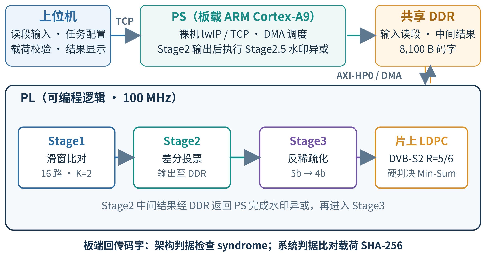

图 1　系统数据流与软硬件划分

Stage2.5 水印异或由 PS 执行，片上 LDPC 位于 PL；图中据此标出软硬件边界。

## 1.2 应用领域

DNA 数字存储研究涵盖信息写入、纠错编码、测序读出和随机访问。已有工作讨论了信息写入 DNA、高容量存储、DNA Fountain 编码及随机访问等方向[2–6]。本作品聚焦读出端的定位、投票与纠错，可用于相关算法映射和板端验证。

短读段比对是序列分析的基础操作，FPGA 加速 DNA 存储模拟也已有研究[7, 8]。本系统把比对、投票和纠错放在同一开发板运行，适合观察数据组织、硬件阶段与码字判据之间的关系，可用于算法研究和嵌入式系统教学。

工程验证时，开发者可输入模拟 FASTQ，检查返回码字、架构判据、系统摘要与分级诊断。系统适用于读出原型评估及软硬件接口实验，结果可按架构判据与载荷摘要复核；实际生物样本仍需另行建立样本处理和实验验证流程。

## 1.3 主要技术特点

本节按计算链路概括作品的实现特点。

（1）Stage1 使用 16 路滑窗并行，每拍处理 2 个碱基（K=2）。高、低位平面分别比较，流水选优树归并得分，同分时保留较低路号。

（2）Stage2 对映射位作差分累加，使用 10 bit 有符号计数器，并按计数符号生成投票结果。Stage2.5 水印异或由 PS 软件执行。

（3）Stage3 在 PL 按 5 bit 一组完成 5b→4b 反稀疏化，组内标志位控制四位取反。

（4）片上 LDPC 在 PL 执行 DVB-S2 R=5/6 硬判决 flooding Min-Sum，syndrome 全零时提前退出；低密度奇偶校验码的译码方法参照相关理论[9–11]，码制依据 DVB-S2 规范[12]。

（5）PS 负责 TCP 通信、DMA、寄存器控制与异常状态，PL 负责四级计算。架构判据检查码字约束，系统判据检查载荷一致性，逐级取证用于定位，便于复核。

## 1.4 主要性能指标

表 1 汇总主要优化测量、定版板测和模拟载荷结果，并在各行注明对应口径。

表 1　主要性能与验证结果

| 指标 | 结果 | 口径 |
| --- | --- | --- |
| Stage1 并行度 | 26.54 s → 8.95 s，2.97× | P4→P16；K=1；全量任务三次中位数 |
| 每拍碱基数 | 9.08 s → 6.06 s，1.50× | P16；K=1→K=2；同小时 A/B |
| 2026.1 定版板测 | t_result 中位数 5.12 s | 2 h；262 轮；26 次恢复探针通过 |
| 双判据 | syndrome 0/10,800；SHA-256 一致 | 板端回传码字与期望载荷 |
| 42 例模拟载荷 | 26 PASS / 16 SAFE_NOCONV / 0 静默错误 | 21 种资产；baseline/challenge；score_min=67 |
| 上传阶段 | 4.27 s → 0.40 s，10.7× | 独立上传阶段测量 |

表内数字对应不同构建与测量窗口，分别列示且不合成为总加速比；上传阶段单独测量。

## 1.5 主要创新点

作品的创新点来自计算链路、判据与验证方式的组合。

（1）PL 串接 Stage1、Stage2、Stage3 和片上 LDPC，PS 执行水印异或与任务控制。

（2）Stage1 组合 16 路滑窗、K=2 位平面存取和流水选优树，并提供配置对照。

（3）syndrome 检查码字约束，SHA-256 检查载荷一致性，四级取证用于故障定位。

（4）SAFE_NOCONV 单独记录，不计通过且不输出误判载荷，保留失败状态。

## 1.6 设计流程

设计流程从 RTL 与接口定义开始，经 Vivado 综合、XSA 导出和 Vitis 软件构建形成制品，再进行检查与板端 G3 验收。器件、时钟及构建身份随流程核对[13, 14]。该过程使硬件实现、软件制品和板端验收记录能够对应到同一构建版本。

如图 2 所示，流程连接逻辑实现、软件构建、制品检查和板端验收。
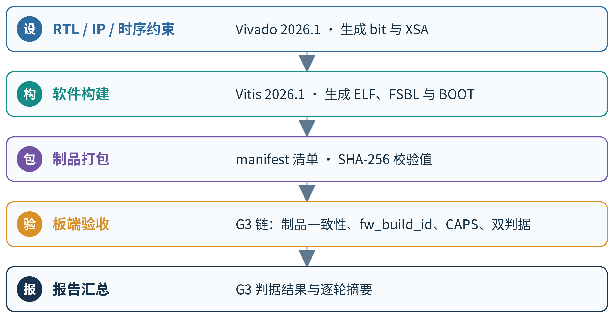

图 2　设计与验证流程

需要注意的是，板端裁决依据 syndrome 与载荷 SHA-256，四级逐级取证用于诊断；验收记录关联构建身份。

# 第二部分　系统组成及功能说明

本部分沿数据从上位机进入板端、在 PL 中处理并返回的方向，说明系统组成、硬件电路和软件控制。先交代共享缓冲与模块边界，再逐级展开 PL 加速模块和 PS/上位机程序。

## 2.1 整体介绍

系统由上位机、BKB220 板载 PS 裸机程序和 PL 加速逻辑组成。上位机读取 FASTQ、生成读段记录并经网络发送；PS 接收任务参数和数据，将读段、水印及中间结果放入共享 DDR，再调度 DMA 与 PL 各级模块；PL 输出经 S2MM 写回 DDR，由 PS 负责后续控制与结果回传。该数据通路围绕 AXI 互联和共享存储构成，控制事务与大块数据搬运分别使用适合的接口[15]。

板端按批大小 64 组织读段，Stage1 将每条读段与参考区作滑窗比对，输出码字、位置和得分；Stage2 按位置将入选记录映射到 81,000 位投票空间，之后由 PS 执行水印异或；Stage3 将 5 bit 组解为 4 bit，片上 LDPC 对得到的 64,800 bit 码字作迭代译码。水印由 40,500 个 2 bit 符号组成，固件按 50 段、每段 957 个符号、段间步长 807 展开后预装到 Stage1。图 3 概括了共享缓冲、DMA 与四级 PL 运算之间的流向。

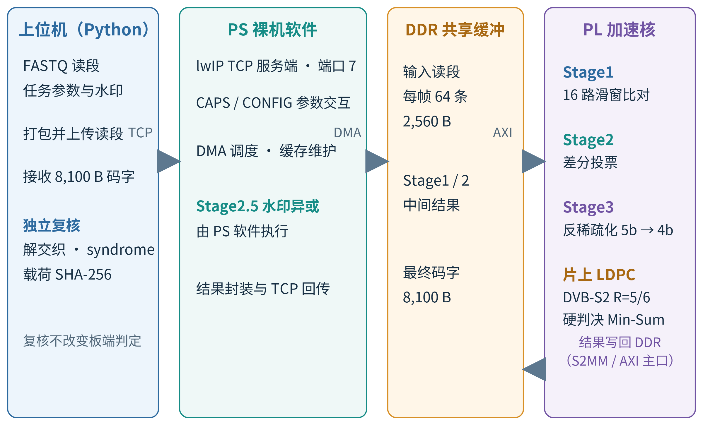

图 3　系统数据通路与共享缓冲

图中 Stage1 结果保存在 DDR 并直接供 Stage2 读取；Stage2 输出随后经过 PS 水印异或，再交给 Stage3 和片上 LDPC，最终码字写回结果区并由网络协议回传。

各级的读写边界也决定了控制顺序：Stage1 生成的 326 bit 记录由 S2MM 打包后写入共享 DDR；Stage2 以 DDR 中的记录为输入，写出投票位流；PS 完成 Stage2.5 水印处理后，Stage3 将位流变换为 LDPC 码字，再交由片上译码器。PS 以任务状态机串接这些阶段，不在软件中重做 PL 的逐位计算。

## 2.2 硬件系统介绍

本节从开发板已有硬件和 PL 自定义逻辑两层说明系统。板级接口承载配置、通信与存储，PL 内各模块沿共享数据通路依次完成比对、投票、反稀疏化和译码。

### 2.2.1 硬件整体介绍

硬件平台采用成品 BKB220 开发板，器件为 Zynq-7000 XC7Z020；PS 侧由 Cortex-A9 处理系统连接 DDR3、GEM 以太网、UART、JTAG，并支持 SD 卡启动。PL 以 100 MHz 工作，集成四级加速核、AXI DMA、Stage1 输出的 S2MM 打包逻辑及 AXI-Lite 控制寄存器。PS 负责协议和任务控制，DMA 在 DDR 与 PL 数据接口间搬运记录，AXI-Lite 用于配置、启动及状态读取[16–18]。

图 4 展示 BKB220 上 PS、PL、外部存储和板级通信接口的组成关系；图中的 PS/PL 边界也对应软件控制和数据计算的分工。

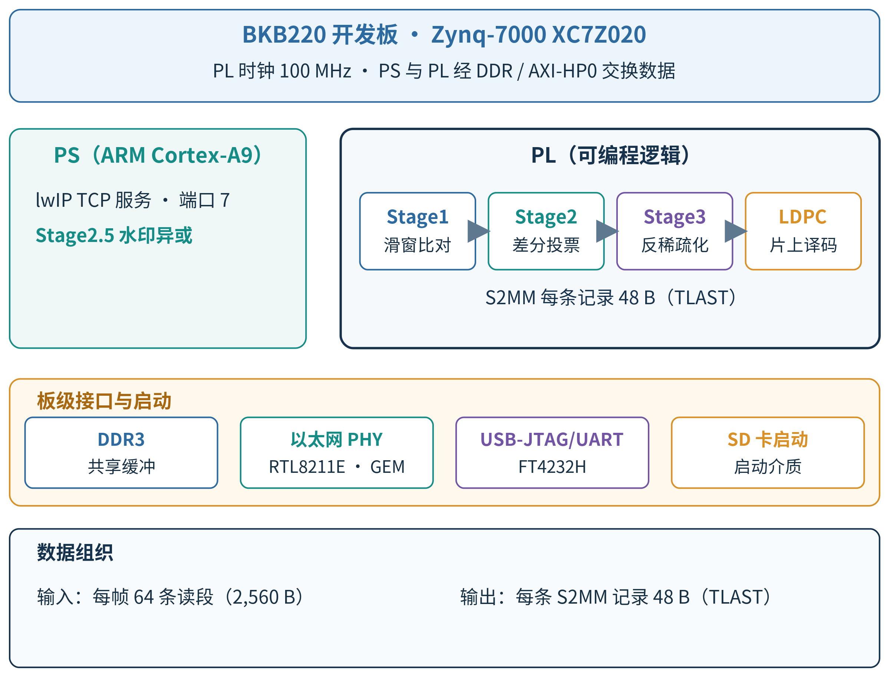

图 4　BKB220 硬件系统组成

板级连接集中列于表 2。以太网连接承担上位机与 PS 间的任务及结果传输，DDR3 则作为 PS 与 PL 共享的数据存储空间。

表 2　板级接口

| 接口 | 连接 | 用途 |
| --- | --- | --- |
| JTAG | FT4232H 调试桥 | PL 配置与调试 |
| UART | FT4232H 串口桥 | 板端日志与验收信息 |
| 以太网 | RTL8211E 网口 | TCP 任务下发与结果回传 |
| DDR3 | PS 外部存储接口 | 读段、水印展开数据、中间结果和码字缓冲 |
| 启动 | SD 卡 | 加载 BOOT.bin 并启动板端程序 |

PL 中，Stage1 以 AXI-Stream 接收记录并将处理结果送往 DMA，Stage2、Stage3 通过存储器映射的 AXI 主接口访问 DDR，片上 LDPC 通过 AXI-Lite 字寄存器装载和读回数据。由此，数据面和控制面在接口层次上分开，PS 可用相同任务状态管理多个处理阶段。

AXI DMA 采用 SG 描述符组织传输：读段输入按帧提交描述符，S2MM 接收端按 Stage1 结果记录提交描述符。该安排使 PS 可以在 DDR 中维护任务数据和阶段结果，再由相应的 PL 主接口按模块协议访问，减少 PS 在计算阶段对数据内容的逐项搬运。

全设计 post-route 资源为 LUT 36,731、FF 38,437、RAMB36 89、RAMB18 2、DSP 6；100 MHz 约束下 WNS +0.089 ns、WHS +0.030 ns，失败端点 0，详表见第三部分表 6、表 7。

### 2.2.2 机械设计介绍

本作品采用成品 BKB220 开发板，未设计附加机箱或结构件，也未自绘 PCB。机械部分不包含独立设计内容。

### 2.2.3 电路各模块介绍

作品使用成品 BKB220 开发板，未改动板载电路、无自绘 PCB；因此本节所说的“电路模块”指 PL 内自行设计的数字电路模块。下文对每个模块依次说明算法原理、电路实现和并行度来源。

Stage1 和 Stage2 之间通过共享 DDR 传递带得分与位置的记录，避免两级被限定为同一条片上流接口；Stage2 的投票输出由 PS 先作水印异或，再供 Stage3 读取。Stage3 输出交给片上 LDPC，后者的控制寄存器可由 PS 访问，译码结果仍由 PS 统一纳入发送流程。

**（1）Stage1 滑窗比对引擎**

**算法原理：**设读段 $r$ 与参考 $w$ 均为 2 bit 符号序列，候选偏移 $d$ 的匹配得分按下式计算。

$$ S(d) = \sum_{j=0}^{149} [r_j = w_{d+j}] $$

式中，$j$ 是读段内碱基索引，$r_j$ 与 $w_{d+j}$ 分别表示读段和参考序列上的 2 bit 符号；方括号内条件成立时取 1，否则取 0，候选位置为 $d \in [0, 807]$。

最优偏移由下式确定。

$$ d^* = \underset{d \in [0, 807]}{\mathrm{arg\,max}}\; S(d) $$

式中，$d^*$ 为得分最高的偏移；存在并列时取较小偏移，跨参考段仅在得分严格更大时更新全局最优值。两位编码拆为高、低位平面；硬件对两平面分别作相等比较，再将结果相与，只有两个编码位都相等时才计入得分。

**电路实现：**输入为 32 bit AXI-Stream，每条 300 bit 读段占 10 拍，末拍 12 bit 有效；输入 FIFO 为 300 bit × 256 深 BRAM。读段以高、低位平面存储，每字 64 bit 对应一批 64 条读段的同一碱基位置；每个位平面再按地址奇偶分为 K=2 个 bank，每个 bank 深 75，A 口供比对读、B 口供装载写。

参考区是可写的 2 bit 同步存储阵列，共 47,850 个槽，分为 2 个 bank、每个 bank 23,925 个槽；固件将 40,500 个参考符号展开为 50 段、每段 957 个符号，经 AXI-Stream 预装。两个 bank 每拍各读出 1 个符号。

比较阵列每拍处理 16 个相邻偏移、2 个碱基和 64 条读段，形成 32 个 64 bit 匹配掩码；单拍得分增量为 0–2，10 bit 得分寄存器记录 0–150 分，一个窗口组处理 75 拍。每段有 51 组候选路，末组仅 8 路有效。选优树为 16→8→4→2→1，共 15 个比较节点、4 级；`PIPE_TREE=1` 时各级打一拍，同拍组内用大于等于关系保留较低路号。最佳分数、位置、区域分别由 10 bit、16 bit、6 bit 寄存器保存，全局位置按 `global_pos = region × STRIDE + pos` 计算。

AXI-Lite 控制窗口为 16 B，含启动/预装/软复位、区域选择、计数器选择和值寄存器；寄存器地址为 0x0（启动、预装、软复位）、0x4（区域）、0x8（计数器选择）和 0xC（计数器值）。输出记录由 300 bit 码字、16 bit 位置和 10 bit 得分组成，共 326 bit；结果 FIFO 深 64，随后由 `s2mm_pack64` 拆成 6 个 64 bit 拍，末拍 6 bit 有效，并在该拍置 TLAST 标志。该接口与同步总线的组织遵循 AXI 事务约定[15]。RTL 默认参数为 `P_WAYS=4`、`PIPE_TREE=0`，定版构建将其覆盖为 `P_WAYS=16`、`PIPE_TREE=1`。参考存储可写，因此区域选择和预装由控制寄存器与 PS 流程共同管理。

**并行度来源：**（1）候选偏移维度采用 16 路滑窗并行；（2）每路每拍比较 2 个碱基，即 K=2；（3）读段维度按 64 条一批共享位平面读出；（4）高、低位平面比较后形成匹配掩码；（5）16 路候选通过四级流水选优树归约，跨组和跨段再更新最优记录。

图 5 给出输入 FIFO、位平面存储、参考区、比较阵列及选优树的连接关系；图中的 16 路计算和 64 bit 匹配掩码对应上述并行维度。

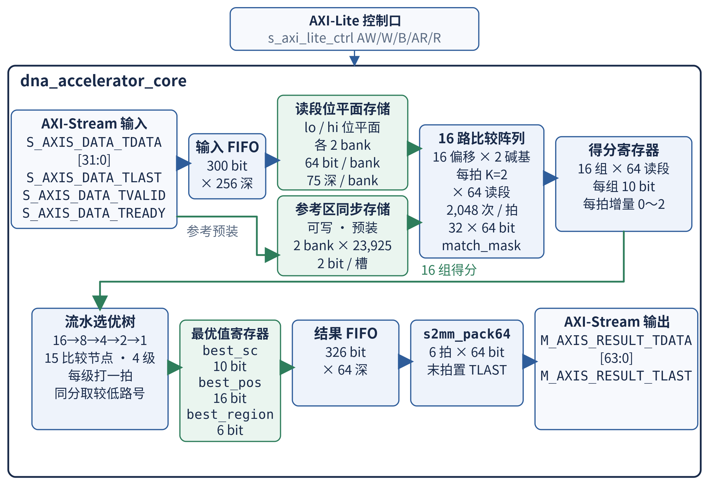

图 5　Stage1 滑窗比对引擎电路结构

结果 FIFO 与 S2MM 打包器将宽记录转换为 AXI-Stream 输出拍，供 DMA 写入 DDR。

**（2）Stage2 差分投票模块**

**算法原理：**对投票空间的位置 $k$，将覆盖该位置的记录位作差分累计，计算式如下。

$$ V_k = \sum_{n \in \mathcal{R}_k} (2b_{n,k}-1) $$

式中，$\mathcal{R}_k$ 为覆盖位置 $k$ 的输入记录集合，$b_{n,k}$ 是记录 $n$ 映射到位置 $k$ 的码字位；位为 1 时贡献 +1，位为 0 时贡献 −1。

投票结果按下式判决。

$$ y_k = [V_k > 0] $$

式中，$y_k$ 是位置 $k$ 的共识位；$V_k$ 为该位置的差分累计值，只有累计值大于 0 时输出 1，计数为零时输出 0。若记录得分低于 `SCORE_MIN`，该记录不参与累加。

读段局部位索引到投票空间地址的映射为：

$$ f(i) = \begin{cases} \mathrm{position}+i, & i<150 \\ \mathrm{position}+40{,}500+(i-150), & 150\le i \end{cases} $$

式中，$i$ 是读段局部位索引，$\mathrm{position}$ 是 Stage1 记录给出的全局匹配位置；两种情况分别对应两个位平面在投票空间前后两半的位置。$k$ 表示投票空间地址，`SCORE_MIN` 是任务配置的分数门限。该判决在汇总计数后为每个位置生成共识位。

**电路实现：**模块以 64 bit AXI4 主接口经 AXI-HP0 访问 DDR，AXI-Lite 寄存器包括 CTRL/STATUS、输入输出地址和拍数、记录总数及 `SCORE_MIN`。输入记录每条读取 6 拍 64 bit，即 48 B；读突发 `ARLEN=5`，并按 4 KiB 边界拆分。投票存储为 BRAM 中的 81,000 个 10 bit 有符号计数器。逐位更新为每拍 1 bit；BRAM 读有两级流水，并以同地址旁路处理连续命中同一计数地址。结果在全部记录读完后统一写出：81,000 bit 结果共 1,266 拍 64 bit，末拍 40 bit 有效且 `WSTRB=0x1F`；写事务为单拍，读阶段与写阶段不重叠。水印异或不在该 RTL 内，由 PS 在 Stage2 输出后执行。

**并行度来源：**DDR 以 64 bit AXI 拍读取记录，单条记录连续读取 6 拍；BRAM 两级读流水与同地址旁路支持连续的逐位更新。核心更新为每拍 1 bit，结果在全部记录读完后统一写出。

图 6 展示 AXI 读入、记录解析、BRAM 计数和结果写出的数据路径；旁路连接用于保持连续地址更新的数据依赖正确。

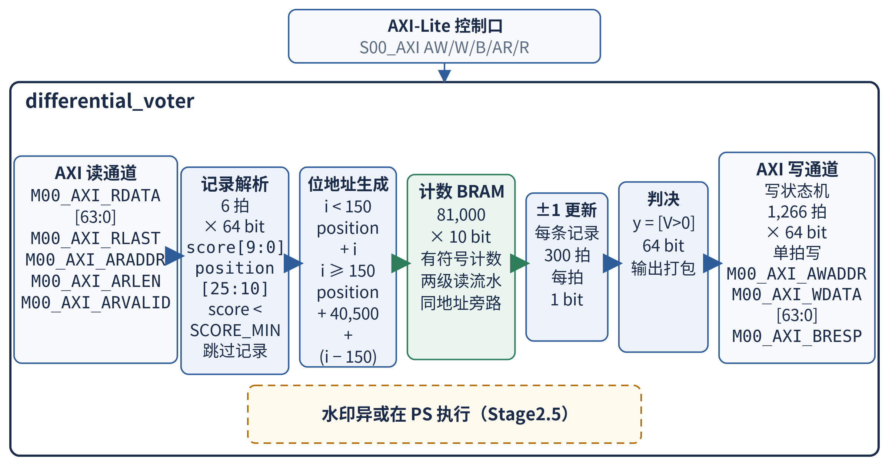

图 6　Stage2 差分投票模块电路结构

图中的 AXI 读、写接口连接共享 DDR，而计数器阵列在读阶段保存逐位累积状态。

**（3）Stage3 反稀疏化模块**

**算法原理：**每个 5 bit 组 $c_g$ 中，$c_{g,0}$ 是标志位，$c_{g,4:1}$ 是待变换的 4 bit 数据；输出按下式计算。

$$ u_g = (c_{g,4}c_{g,3}c_{g,2}c_{g,1}) \oplus (c_{g,0}c_{g,0}c_{g,0}c_{g,0}) $$

式中，$g$ 表示组序号，$c_{g,4:1}$ 为组内数据位，$c_{g,0}$ 为标志位；标志为 0 时保留原 4 位，为 1 时逐位取反，$\oplus$ 表示按位异或。异或项由标志位广播到输出的四个数据位，组内每一位独立完成翻转。模块按固定组边界消费输入和产生输出，位宽从 5 bit 变为 4 bit；多个组的转换结果需重新连续拼接。

**电路实现：**模块每次转换 8 组，即 40 bit 输入映射为 32 bit 输出。主接口为 64 bit AXI，突发长度最多 256 拍，并受剩余数据量和 4 KiB 边界约束；读状态机与写状态机相互独立，允许读写通道重叠。输入暂存为 128 bit，输出暂存为 96 bit；接口寄存器由 AXI-Lite 提供，`0x10` 的 bit0 为 START。总处理量为 81,000 bit 输入、64,800 bit 输出，共 16,200 个 5 bit 组。数据变换由异或逻辑完成，不采用查表映射。

**并行度来源：**（1）组合变换单元一次并行处理 8 个 5 bit 组；（2）AXI 主接口按 64 bit 数据拍搬运；（3）独立读、写状态机使数据读取和结果写回可以重叠；（4）输入、输出暂存分别承接不同宽度的数据块，配合 5 bit 到 4 bit 的组间打包。

图 7 展示输入暂存、8 组异或变换、输出暂存以及独立 AXI 读写控制的连接；读写重叠发生在接口状态机之间。

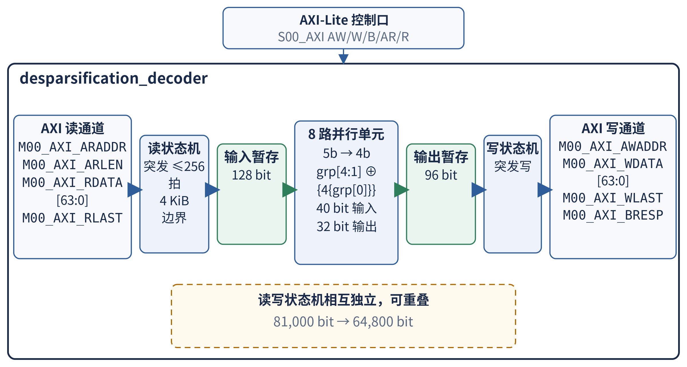

图 7　Stage3 反稀疏化模块电路结构

输出端将每组 4 bit 数据连续打包，形成供片上 LDPC 读取的码字位流。

**（4）片上 LDPC 译码器**

**算法原理：**译码采用 DVB-S2 R=5/6 的硬判决 flooding Min-Sum。校验节点 $c$ 到变量节点 $v$ 的消息按下式计算。

$$ R_{c\to v} = \left( \prod_{u \in N(c)\setminus v} \mathrm{sgn}(L_u) \right) \cdot \min_{u \in N(c)\setminus v} |L_u| $$

式中，$u$ 是邻接变量节点，$N(c)\setminus v$ 表示与校验节点 $c$ 相连但不含目标变量 $v$ 的集合，$L_u$ 是变量节点输入 LLR，$\mathrm{sgn}$ 取符号，$\min$ 取幅值最小值；任一输入为 0 时消息为 0。

变量节点更新按下式进行，输出按符号硬判决。

$$ L_v' = \mathrm{clip}\left(6(2b_v-1)+\sum_{c \in N(v)}R_{c\to v}, -32, 31\right) $$

式中，$b_v$ 是硬判决输入位，$N(v)$ 是与变量节点 $v$ 相连的校验节点集合；$\mathrm{clip}$ 将变量 LLR 截断到给定区间，校验消息求和后与输入 LLR 合并。

校验关系的 syndrome 按下式计算，全零时提前退出。

$$ s = H\hat{b}^{\mathrm{T}} \ \mathrm{mod}\ 2 $$

式中，$H$ 为校验矩阵，$\hat{b}$ 为按符号硬判决得到的码字，$s$ 为 syndrome。该算法及码制依据低密度奇偶校验码与 DVB-S2 规范[9–12]。输入位映射为 6 bit LLR ±6，按 flooding 调度更新消息；校验消息采用 7 bit 量化且不作归一化。

**电路实现：**码长 `N=64,800`、校验行数 `M=10,800`、信息位数 `K=54,000`。校验矩阵地址由 `bt_rom` 的 600×32 块 ROM 与 `bt_off_rom` 的 31×12 分布式 ROM 提供；硬判决位映射为 6 bit LLR ±6，校验消息为 7 bit，`sum_mem` 为 12 bit，译码结果为 1 bit。存储组织为输入 1×N、LLR 6×N、sum 12×N、结果 1×N。模块仅有 AXI-Lite 接口，寄存器为 CONTROL、STATUS、LOAD_WORD_ADDR、LOAD_WORD_DATA、RESULT_WORD_ADDR、RESULT_WORD_DATA。最大迭代次数为 50；固件在 PREP 阶段解交织、RUN 阶段装载并启动/轮询，仅在收敛时 READBACK 写回，未收敛则置错误状态并保留 Stage3 输出。AXI-Lite 地址 0x00/0x04 对应控制与状态，0x08/0x0C 对应装载字地址与数据，0x10/0x14 对应结果字地址与数据。

**并行度来源：**（1）完整码字的迭代在 PL 内完成，PS 只经 AXI-Lite 装载、启动和读回；（2）校验矩阵、LLR、累加和与译码结果均存于片上，迭代过程不经 DDR；（3）syndrome 全零即提前退出，未收敛时运行至 50 次迭代上限。校验行按行、按边串行处理：第 0 行行度为 21，其余各行为 22。

图 8 给出校验矩阵 ROM、消息/累加存储、译码计算单元与 AXI-Lite 控制接口；按行、按边串行的处理顺序构成该核的实现边界。

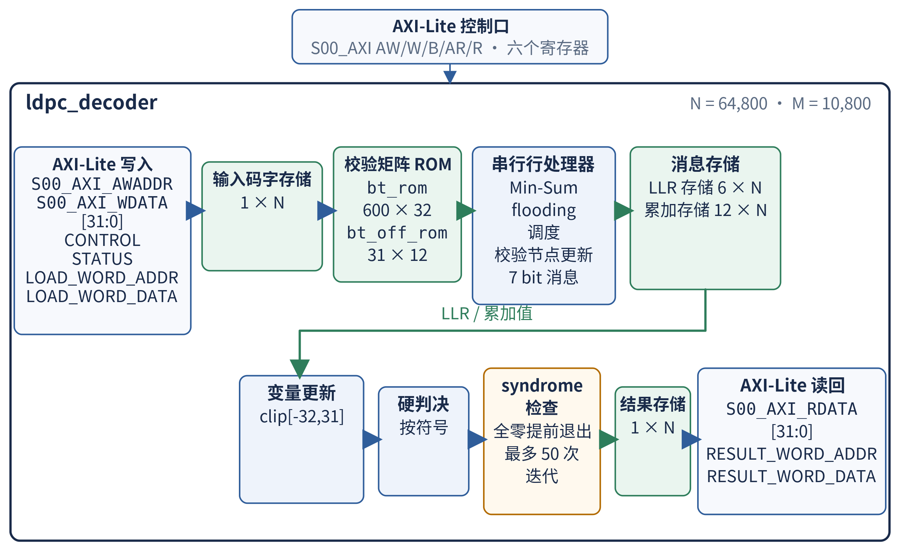

图 8　片上 LDPC 译码器结构

PS 仅在译码收敛时读取译码结果；该核输出码字随后进入结果缓冲并由 PS 回传。

## 2.3 软件系统介绍

软件部分分为 PS 裸机固件和上位机。PS 通过网络协议接收任务、管理共享 DDR、驱动 PL 并回传结果；上位机负责输入文件准备、数据打包和结果复核。

### 2.3.1 软件整体介绍

PS 端以裸机 lwIP TCP/IP 协议栈提供任务服务，完成能力查询、参数校验、读段接收、DMA 调度、各 Stage 驱动和结果发送；上位机负责 FASTQ 处理、任务配置、反向互补展开、上传及码字复核。PS 主流程将协议和控制逻辑与 PL 中的定长运算分开：以太网报文在 PS 解析，读段和阶段输出通过 DDR 与 DMA 交接，比对、投票、反稀疏化及 LDPC 译码在 PL 中执行。该分层与 lwIP 的 TCP/IP 软件栈职责相符[19]。

上位机先读取板端 CAPS 信息，再按相同的几何与任务参数形成 CONFIG；板端确认参数后才接收水印和读段帧。PS 在连接上下文中维护配置及已接收记录状态，处理完任务再按结果协议发送码字。上位机解包和解交织后计算 syndrome，并按任务给定的载荷长度提取信息位、计算 SHA-256，形成可供用户查看的校验状态和载荷预览。由此，上位机既完成文件和网络工作，也能对板端返回内容复核，但不替换板端计算路径。

这套分层还限定了职责边界：反向互补读段在上传前由上位机生成，板端 Stage1 仅处理收到的编码记录；板端固件对 LDPC 做 PREP、RUN 和按收敛状态 READBACK，上位机 LDPC 工具只复核回传码字。因而网络任务、硬件运算和结果校验沿同一任务记录衔接，控制侧可报告结果状态而不改写 PL 判定。

图 9 归纳上位机、PS 固件、AXI DMA、共享 DDR 和 PL 各级计算模块之间的调用及数据关系；上位机与 PS 通过网络交互，PS 再通过寄存器和 DMA 控制 PL。

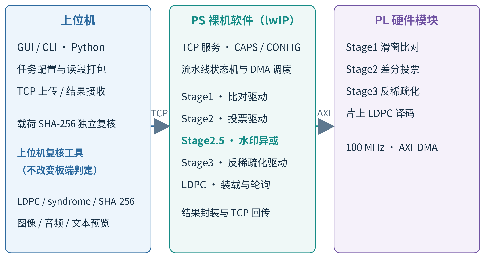

图 9　软件系统架构

图 9 的上位机、PS 与 PL 三层依次对应任务组织、控制调度和定长运算。

### 2.3.2 软件各模块介绍

软件流程自上而下分为 PS 板端服务和上位机。图 10 展示 PS 流水线状态推进，图 11 展示上位机从文件输入到结果预览的任务步骤。

PS 从 `main` 进入平台和网络初始化，随后启动 lwIP TCP 监听服务（端口 7）；上位机连接后先进行 CAPS 能力查询和 CONFIG 参数下发，再上传参考水印与读段帧。每帧包含 64 条读段、共 2,560 B；PS 接收并写入 DDR，之后启动 DMA 和各级驱动。Stage1 通过 S2MM 接收打包结果，Stage2 从 DDR 读记录并写投票结果，PS 执行水印异或，Stage3 及片上 LDPC 继续处理。状态机依次推进 IDLE、STAGE1、VOTER、DECODER、LDPC、SEND_RESULT，异常或超时进入 FAIL；完成后经 TCP 回传带协议头的 8,100 B 码字结果包。

图 10 中的状态顺序说明各级由 PS 分段驱动，PL 完成后再转入下一阶段；异常状态收敛到 FAIL。

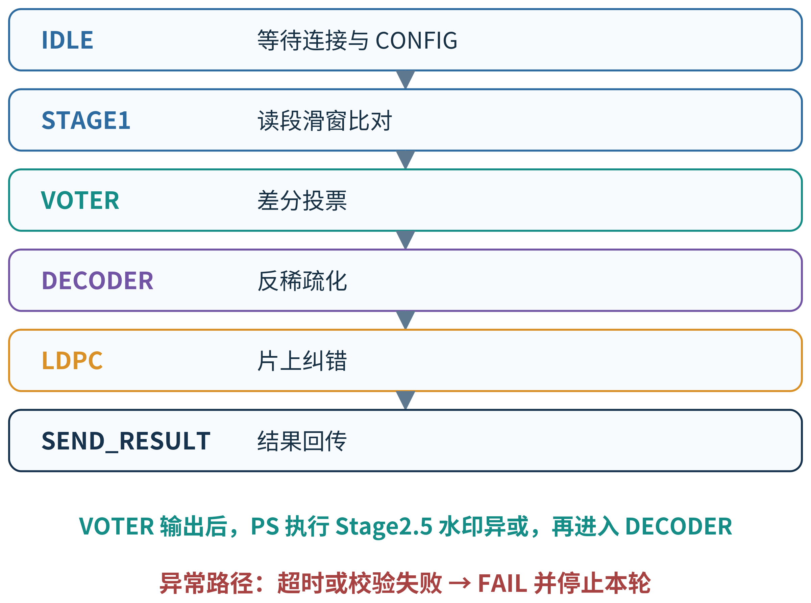

图 10　PS 流水线状态机

上位机先加载 FASTQ 并展开每条读段的正向与反向互补记录，再打包读段和水印、查询能力、下发配置并上传。收到板端结果后，上位机解包码字、解交织并复核 syndrome，通过后按输入长度提取载荷、计算 SHA-256 并生成预览。上位机的 LDPC 工具仅用于复核；板端译码未通过时，上位机不进行译码兜底，板端判定保持不变。

图 11 展示上位机从 FASTQ 文件到码字校验及载荷预览的顺序，其中 syndrome 复核先于载荷哈希与预览。

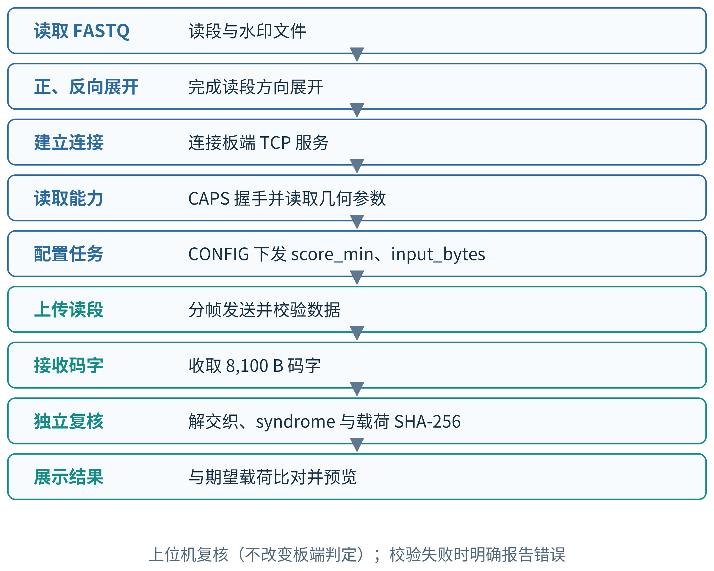

图 11　上位机任务流程

表 3 汇总软件与 PL 间的主要数据及控制接口；表 4 和表 5 分别列出固件函数、上位机模块的输入输出。

表 3　软硬件接口

| 接口 | 方向/形式 | 输入与输出 |
| --- | --- | --- |
| AXI-Lite | PS 控制 PL | 配置寄存器、启动各级、读取状态 |
| AXI-Stream | PS/DMA 至 Stage1，Stage1 至 DMA | 32 bit 读段输入；64 bit 结果输出 |
| AXI DMA（SG） | DDR 与 Stage1 数据通路 | 读段和水印送入 PL，S2MM 结果写入 DDR |
| AXI4 Master / AXI-HP0 | Stage2 访问 DDR | 读取 Stage1 记录并写出投票结果 |
| AXI4 Master | Stage3 访问 DDR | 读取投票位流并写出反稀疏化结果 |
| TCP 端口 7 | 上位机与 PS | CAPS/CONFIG、任务数据、状态和结果传输 |

表 4　PS 固件主要函数及输入输出

| 文件/函数 | 输入 | 输出 | 作用 |
| --- | --- | --- | --- |
| main.c：`main` | 板端启动环境 | 初始化后的服务循环 | 初始化平台、lwIP、网络接口和 IP 核并启动 TCP 服务 |
| proto.c：`process_caps` | CAPS 请求、连接 | CAPS_INFO 能力响应 | 返回板端任务能力 |
| proto.c：`process_config` | CONFIG 负载及长度 | 配置状态响应 | 校验任务参数并保存配置 |
| echo.c：`process_batch` | 帧计数和读段记录 | DDR 中的记录、接收状态 | 校验并接收批次数据 |
| echo.c：`process_post` | POST 请求及已收数据状态 | 流水线启动请求或错误响应 | 校验任务完整性并请求处理 |
| stage1_dna.c：`pipeline_step_stage1` | 任务状态、读段和水印缓冲 | Stage1 进度与状态 | 预装参考并驱动滑窗计算 |
| stage2_voter.c：`pipeline_step_stage2` | Stage1 DDR 结果和任务参数 | 投票结果与状态 | 配置、启动并轮询差分投票器 |
| stage2_voter.c：`apply_watermark_differential` | Stage2 位流及水印 | 异或后的位流 | 在 PS 执行 Stage2.5 水印异或 |
| stage3_decoder.c：`pipeline_step_stage3` | Stage2 位流 | Stage3 输出缓冲和状态 | 配置、启动并轮询反稀疏化模块 |
| ldpc_onchip.c：`pipeline_step_ldpc` | Stage3 码字 | 收敛码字或错误状态 | 解交织、装载、启动/轮询并按状态读回 |
| echo.c：`send_result` | 结果缓冲 | TCP 结果报文 | 回传板端码字 |

表 5　上位机主要模块及输入输出

| 文件 | 输入 | 输出 | 作用 |
| --- | --- | --- | --- |
| `gui_app.py` | FASTQ、任务参数和板端地址 | 进度、校验结果和载荷预览 | 图形界面组织完整任务 |
| `first.py` | 文件路径、连接和任务配置 | 上传、接收结果文件及统计 | 命令行任务流程 |
| `fast_readout.py` | FASTQ 序列及方向选项 | 打包读段记录和网络负载 | 批量编码、正反向展开及结果解包 |
| `protocol.py` | TCP socket、报文类型和负载 | CAPS、ACK、配置及结果报文 | 处理帧封装与收发 |
| `task_protocol.py` | 任务几何、读段数和分数阈值 | TaskSpec 与配置负载 | 描述并校验任务参数 |
| `ldpc_pipeline.py` | 板端回传码字及预期载荷信息 | syndrome 复核结果和提取载荷 | 复核板端结果，不改变板端判定 |

# 第三部分　完成情况及性能参数

本部分依次说明系统实物连接、工程实现结果和主要性能证据。资源与时序数据对应 2026.1 布线后报告，结构参数与测试结论分别按电路事实和现有验收记录整理。

## 3.1 整体介绍

系统由 BKB220 开发板、上位机、USB 连接线、以太网线和供电组成。上位机通过以太网与板端交换任务数据和结果；USB 连接用于 JTAG 下载与调试，并通过 UART 获取设备日志，供电接入开发板电源接口。

运行时，上位机准备读段、水印及参数并发送任务，板载 PS 处理网络协议、任务调度和 DMA 搬运，PL 完成读段比对、差分投票、反稀疏化及片上 LDPC 译码；结果由 PS 回传至上位机。开发板与线缆的实物连接关系如图 12 所示，相关平台连接方式参照开发板硬件资料[18]。

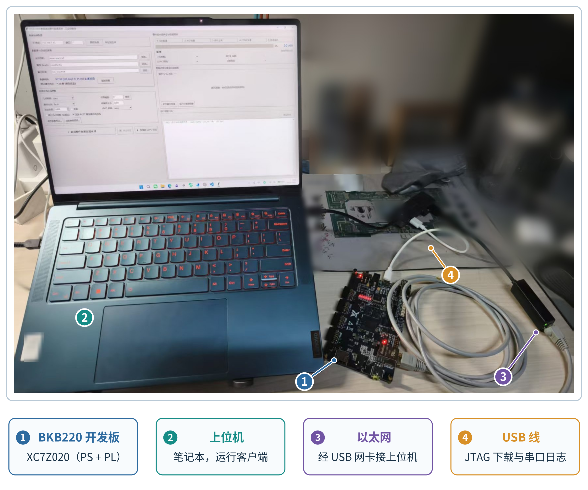

图 12　系统实物与连接

图 12 中编号 1～4 依次对应开发板、上位机、以太网和 USB 连接线（JTAG 下载与串口日志），可据此辨认数据通信与调试观察两类连接。

## 3.2 工程成果

本节从机械结构、电路实现和软件运行三个方面归纳工程交付情况，并以布线后资源报告、时序报告和板端验收输出来说明实现状态。

### 3.2.1 机械成果

本作品直接使用 BKB220 开发板，没有额外机械结构设计。

### 3.2.2 电路成果

2026.1 构建完成 PL 逻辑实现，资源统计取自层次化 post-route 报告；表 6 汇总主要模块的 LUT、触发器、片上 RAM 与 DSP 占用，表 7 按建立时间、保持时间和脉冲宽度列出时序结果。

表 6　PL 主要模块资源占用（2026.1，post-route）

| 模块 | LUT | FF | RAMB36 | RAMB18 | DSP |
| --- | ---: | ---: | ---: | ---: | ---: |
| dna_accelerator_core（Stage1） | 29,166（Logic 28,730 / LUTRAM 436） | 28,167 | 16 | 1 | 5 |
| differential_voter（Stage2） | 1,041 | 1,897 | 30 | 0 | 0 |
| desparsification_decoder（Stage3） | 1,043 | 935 | 0 | 0 | 0 |
| ldpc_decoder（片上 LDPC） | 830 | 789 | 41 | 0 | 1 |
| axi_dma | 1,992 | 3,805 | 2 | 1 | 0 |
| AXI 互联（ic_hp + ic_lite） | 2,647（2,041 + 606） | 2,807（2,148 + 659） | 0 | 0 | 0 |
| 全设计 | 36,731 | 38,437 | 89 | 2 | 6 |

表 7　时序汇总（100 MHz，post-route）

| 指标 | 建立时间 | 保持时间 | 脉冲宽度 |
| --- | --- | --- | --- |
| 裕量 | WNS +0.089 ns | WHS +0.030 ns | WPWS 3.000 ns |
| 负裕量总和 | TNS 0.000 ns | THS 0.000 ns | TPWS 0.000 ns |
| 失败端点 / 总端点 | 0 / 95,487 | 0 / 95,487 | 0 / 39,469 |

Stage1 的 LUT 与 FF 占用最多；RAMB36 主要用于片上 LDPC 的码字与消息存储及 Stage2 的投票计数器；表中仅列主要模块，全设计行另含其余辅助逻辑。表 7 汇总建立、保持和脉冲宽度检查，三类检查均为零失败端点。

### 3.2.3 软件成果

上位机运行界面将连接配置、数据源探测、流水线参数、运行状态、性能信息、结果校验和日志显示分区呈现，便于查看任务从数据准备到结果检查的状态。图 13 展示上位机主界面；各分区对应的操作和状态信息共同构成板端任务的控制与观察入口。

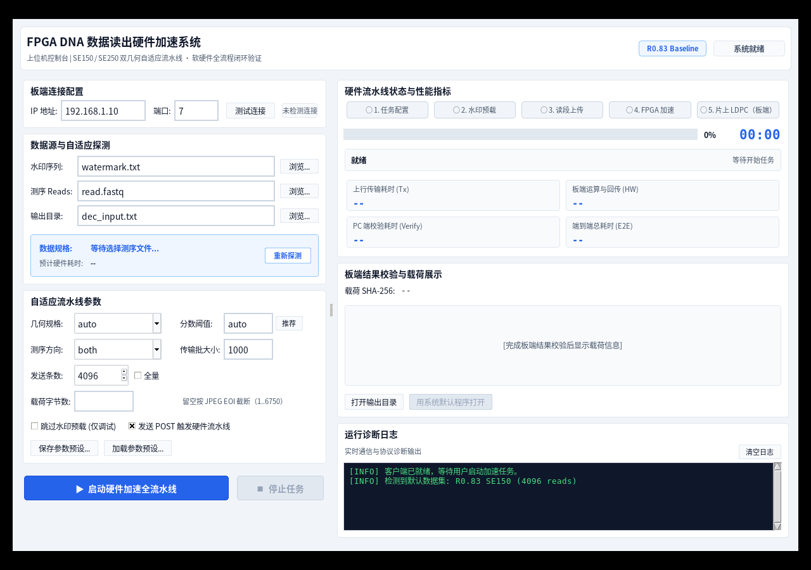

图 13　上位机运行界面

界面中的参数区和状态区为任务配置、运行进度及结果检查提供集中视图。板端 G3 验收按制品一致性、烧录、固件构建身份、CAPS 就绪、架构判据、系统判据和四级逐级取证输出状态。

以下为节选，省略回传计时与串口记录行：

```text
本次裁决     : PASS（架构判据与系统判据均通过；诊断层不参与裁决）

结果  步骤
PASS    完整制品包一致性（所选SHA/XSA内bit/part/参数）  — ../build/artifact
PASS    烧录
PASS    板上固件构建身份核对（fw_build_id）  — 期望=bfcd40dd3c435a19；实读=bfcd40dd3c435a19
PASS    板端应用层就绪（CAPS）  — READY 3.0 1
PASS    第 1 轮架构判据（板端 syndrome 全零）  — 0/10800 条非零校验行
PASS    第 1 轮系统判据（板端码字载荷 SHA）  — 来源=板端合法码字直接提取
PASS    四级逐级取证（board_stage_check.py）
```

上述输出节选按逐项状态呈现验收链：架构判据与系统判据记录板端计算和载荷一致性，四级逐级取证用于定位处理阶段。

## 3.3 特性成果

本节中 t_result 表示板端从下发任务到收齐结果的耗时；不同构建版本与不同测量窗口的数据分别列示，不相加或相乘合成为单一结果；本报告没有同一输入、同一测量边界下的 CPU 对照。

**（1）Stage1 滑窗比对引擎**

Stage1 将 2 bit 碱基拆成高、低位平面，匹配得分按式（1）计算；最终位置由最高得分偏移确定，平分时取较小偏移。定版每拍并行处理 16 个相邻偏移、2 个碱基和 64 条读段，并通过 16 路流水选优树收敛候选得分。并行度对照为 P4 到 P16、K=1 时 26.54 s 降至 8.95 s，提升 2.97×，取同类全量任务三次运行中位数；每拍碱基数对照为 P16 下 K=1 到 K=2 的 9.08 s 降至 6.06 s，提升 1.50×，为同小时 A/B 各一次运行。表 8 列出 Stage1 的主要特性参数。

表 8　Stage1 滑窗比对引擎特性参数

| 参数 | 值 | 说明 |
| --- | --- | --- |
| 并行配置 | P_WAYS=16，PIPE_TREE=1 | 定版构建配置 |
| 单拍比较规模 | 16 个偏移 × 2 个碱基 × 64 条读段 | 每拍 2,048 次 2-bit 符号比较 |
| 读段与窗口组 | 150 bp；75 拍 / 组 | 每拍处理 K=2 个碱基 |
| 参考区域 | NUM_LC=50，REF_LEN=957，STRIDE=807 | 构建配置 |
| 候选位置 | 0–807 | 每段 51 组，末组 8 路有效 |
| 选优树 | 16→8→4→2→1；15 个节点、4 级 | 每级寄存一级结果，同分选择较低路号 |
| 模块资源 | LUT 29,166；FF 28,167；RAMB36 16；RAMB18 1；DSP 5 | post-route |

**（2）Stage2 差分投票模块**

Stage2 按 Stage1 输出的位置，将每条 300 bit 记录的两段位平面映射到 81,000 个位置计数器。每个 bit 对应的票值为 1 时累加、为 0 时递减，最后按 $V_k > 0$ 生成共识位；每条记录逐 bit 处理，所有记录读取完成后再打包输出。投票结果之后的水印异或由 PS 软件执行。表 9 列出 Stage2 的主要特性参数。

表 9　Stage2 差分投票模块特性参数

| 参数 | 值 | 说明 |
| --- | --- | --- |
| 计数存储 | 81,000 个 10 bit 有符号计数器 | BRAM 存储 |
| 输入记录 | 326 bit / 条（含 300 bit 码字）；每条读取 6 拍 64 bit | 另含得分与位置字段 |
| 处理规则 | 每拍处理 1 bit | 300 bit 码字逐位累加或递减 |
| 输出数据 | 81,000 bit；1,266 拍 64 bit | 末拍有效 40 bit |
| 访问接口 | 64 bit AXI4；AXI-Lite 控制寄存器 | 经 AXI-HP0 访问 DDR |
| 模块资源 | LUT 1,041；FF 1,897；RAMB36 30；RAMB18 0；DSP 0 | post-route |

**（3）Stage3 反稀疏化模块**

Stage3 对每组 5 bit 输入取其中 4 bit 数据和 1 bit 标志：标志位为 0 时保留数据位，为 1 时对数据位逐位异或翻转。模块每次转换 8 组，将 40 bit 输入转换为 32 bit 输出；读、写状态机可重叠运行，分别由输入和输出暂存空间衔接 AXI 数据流。表 10 列出 Stage3 的主要特性参数。

表 10　Stage3 反稀疏化模块特性参数

| 参数 | 值 | 说明 |
| --- | --- | --- |
| 分组映射 | 5 bit → 4 bit | 最低位为标志，与 4 个数据位异或 |
| 单次转换 | 8 组；40 bit → 32 bit | 组合逻辑转换 |
| 输入 / 输出暂存 | 128 bit / 96 bit | 读写状态机独立，可重叠 |
| AXI 访问 | 64 bit；突发长度最多 256 拍 | 受剩余数据量和 4 KiB 边界约束 |
| 转换总量 | 81,000 bit → 64,800 bit；16,200 组 | 5b→4b |
| 模块资源 | LUT 1,043；FF 935；RAMB36 0；RAMB18 0；DSP 0 | post-route |

**（4）片上 LDPC 译码器**

片上 LDPC 采用 DVB-S2 R=5/6 硬判决 flooding Min-Sum，对 64,800 bit 码字按行和边串行更新校验消息与变量消息，最多执行 50 次迭代，并在 syndrome 全零时提前结束。译码矩阵由块 ROM 和分布式 ROM 存储，片上 RAM 保存输入、消息累加和译码结果；PS 仅在译码收敛时读取译码结果。表 11 列出片上 LDPC 的主要特性参数。

表 11　片上 LDPC 译码器特性参数

| 参数 | 值 | 说明 |
| --- | --- | --- |
| 码参数 | N=64,800，M=10,800，K=54,000；R=5/6 | DVB-S2 |
| 译码方法 | 硬判决 flooding Min-Sum | syndrome 全零提前退出 |
| 最大迭代 | 50 次 | 每行 / 每边串行处理 |
| 消息与累加位宽 | 校验消息 7 bit；sum_mem 12 bit | 硬判决输入 LLR 为 ±6 |
| 矩阵存储 | bt_rom 600×32；bt_off_rom 31×12 | 块 ROM 与分布式 ROM |
| 模块资源 | LUT 830；FF 789；RAMB36 41；RAMB18 0；DSP 1 | post-route |

**（5）系统性能与验收**

图 14 将两组 Stage1 对照、2026.1 定版板测中位数和独立上传段测量分成四组显示，并在每组标注自己的测试口径。

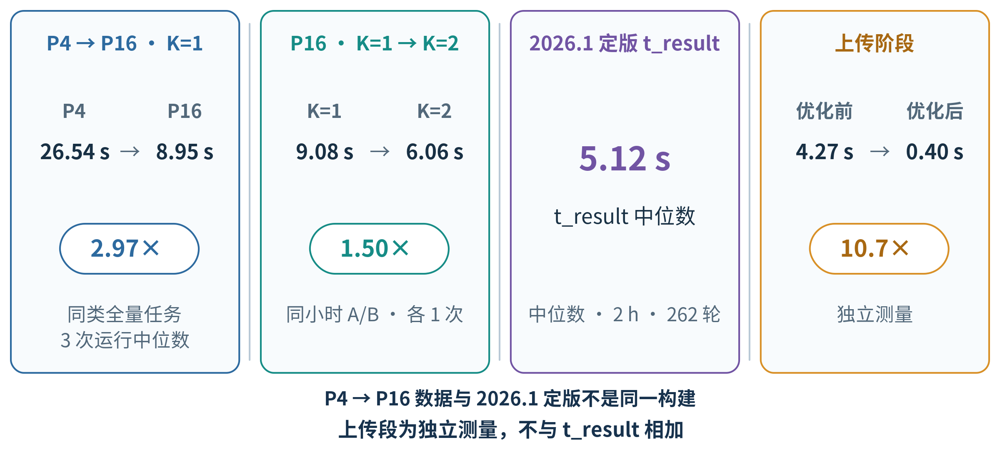

图 14　各配置性能对比与测量口径

2026.1 定版板测的 t_result 中位数为 5.12 s，测量窗口为 2 h，共 262 轮；每轮处理 103,616 条记录，26 次恢复探针均通过。上传段单独测得 4.27 s 至 0.40 s，倍率为 10.7×。两组 Stage1 对照与上述结果各自对应图中的测量口径。验收判据与对应的验证结果汇总于表 12。

表 12　验收判据与证据摘要

| 判据 | 验证结果 | 边界说明 |
| --- | --- | --- |
| 架构判据 | syndrome 为 0/10,800 | 板端回传码字校验位全零 |
| 系统判据 | 载荷 SHA-256 命中 | 与期望载荷逐轮比对 |
| 四级逐级取证 | 水印 / Stage1 / Stage2 / Stage3 逐级核对 | 用于诊断，不代替硬判据 |
| 42 例模拟载荷 | 26 PASS / 16 SAFE_NOCONV / 0 静默错误 | 21 种资产 × baseline/challenge，score_min=67；模拟 FASTQ |
| 2026.1 长稳 | 2 h，262 轮，26 次恢复探针通过 | 该制品独立统计 |
| v1.1 长稳 | 8 h，1,736 轮，173 次恢复探针通过 | 另一制品独立统计 |

42 例模拟载荷评估覆盖 21 种资产分别形成的 baseline 与 challenge 输入，其中 26 例通过，16 例为 SAFE_NOCONV，静默错误计数为 0；不收敛结果作为失败报告且不输出误判载荷。长稳记录分别对应 2026.1 与 v1.1 制品：前者为 2 h、262 轮和 26 次恢复探针，后者为 8 h、1,736 轮和 173 次恢复探针，均为各自记录中的通过结果。

图 15 展示 G3 的判定顺序，并将硬判据和诊断步骤分别标注：制品包一致性 → 烧录 → fw_build_id → CAPS → 架构判据 syndrome 0/10,800 → 系统判据载荷 SHA-256 → 四级逐级取证（仅诊断）。

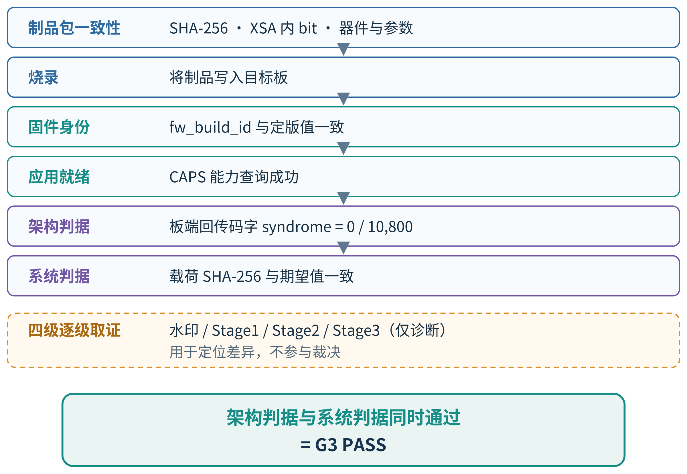

图 15　板端验收判据与分级诊断

其中，架构判据与系统判据同时满足才形成 G3 通过结论；四级逐级取证用于故障定位，不参与裁决。

# 第四部分　总结

本部分归纳可继续推进的技术方向，并记录研发、实现和验证过程中的工程取舍。

## 4.1 可扩展之处

后续可从计算规模、译码能力与系统运行条件三方面扩展。可在更大器件上评估 Stage1 并行度，结合 bank 访问方式改进 K=2 地址生成路径，并研究更高每拍碱基数的实现空间；可比较软判决或分层 LDPC 译码对难例收敛和片上存储需求的影响；系统侧可开展 QSPI 冷启动验证、板端功耗测量，并研究批处理调度与多板协同。上述方向均需另行实现，并在明确资源、时序与测量边界后再纳入版本评估。评估时可分别记录资源变化、关键路径、译码收敛表现及任务测量范围，使新增实现与现有结果保持清晰对应。

## 4.2 心得体会

研发从工具链迁移和工程基线整理开始。Vivado 用于逻辑实现与硬件平台导出，Vitis 用于 PS 固件构建；迁移后需重新核对 RTL/IP、约束、平台文件和软件工程。制品记录同时关联构建参数、器件信息、固件构建身份与哈希清单，使板测结果能够回指对应版本。

并行度选择需要同时考虑局部性能、整机资源和布线时序。Stage1 从 P4 扩至 P16 后，同类全量任务耗时下降；在 P16 下将每拍碱基数从 K=1 调至 K=2，并以奇偶 bank 和 bank 内地址组织读段存储。K=4 资源需求超过器件可用范围；K=3 的地址生成包含除以 3 的运算，时序未满足要求。因此定版采用 K=2，并依据布线后资源及时序报告检查实现。

实际数据链也决定软硬件划分。Stage1 接收帧化读段并输出打包记录，PS 通过 DMA 与 PL 协作；Stage2 从 DDR 中间结果逐位更新 10 bit 有符号计数器并生成投票码字。Stage2.5 水印异或由 PS 执行，Stage3 在 PL 将 5 bit 组转换为 4 bit，片上 LDPC 在 PL 内运行硬判决 flooding Min-Sum。对照接口和数据宽度逐级核验，有助于避免把软件操作误写成硬件逻辑，或混淆各阶段的输入输出。

验证判据从只检查最终载荷调整为分层裁决：板端回传码字 syndrome 全零作为架构判据，载荷 SHA-256 与期望一致作为系统判据，两项都通过才记为通过。水印、Stage1、Stage2、Stage3 的四级逐级取证只保留为诊断信息，不参与裁决；验收脚本直接对板端回传码字计算 syndrome。

42 例模拟测试覆盖 21 种资产的 baseline 与 challenge 输入，在 score_min=67 时得到 26 PASS、16 SAFE_NOCONV、0 静默错误。SAFE_NOCONV 表示译码未收敛，系统报告失败，不计为通过且不输出误判载荷。2026.1 定版的 2 h 板测、262 轮和 26 次恢复探针与其他制品的长稳记录分别归档，确保每项数据对应其构建身份。

工程记录应把模块实现、构建身份、裁决判据和测量口径连在一起。性能数据注明配置与阶段，验收记录保留硬判据和诊断信息，不收敛情况按失败状态记录；这些信息为后续更换器件、译码方案或运行方式提供对照。本报告的范围边界是：42 例来自模拟 FASTQ 而非湿实验，不同构建与测量窗口分别列示且不合成为总加速比，也没有同边界 CPU 对照。

# 第五部分　参考文献

[1] Cock P J A, Fields C J, Goto N, et al. The Sanger FASTQ file format for sequences with quality scores, and the Solexa/Illumina FASTQ variants[J]. Nucleic Acids Research, 2010, 38(6): 1767-1771.
[2] Church G M, Gao Y, Kosuri S. Next-generation digital information storage in DNA[J]. Science, 2012, 337(6102): 1628.
[3] Goldman N, Bertone P, Chen S, et al. Towards practical, high-capacity, low-maintenance information storage in synthesized DNA[J]. Nature, 2013, 494(7435): 77-80.
[4] Erlich Y, Zielinski D. DNA Fountain enables a robust and efficient storage architecture[J]. Science, 2017, 355(6328): 950-954.
[5] Organick L, Ang S D, Chen Y J, et al. Random access in large-scale DNA data storage[J]. Nature Biotechnology, 2018, 36(3): 242-248.
[6] Ceze L, Nivala J, Strauss K. Molecular digital data storage using DNA[J]. Nature Reviews Genetics, 2019, 20(8): 456-466.
[7] Li H, Durbin R. Fast and accurate short read alignment with Burrows-Wheeler transform[J]. Bioinformatics, 2009, 25(14): 1754-1760.
[8] Marelli A, et al. Integrating FPGA acceleration in the DNAssim framework for faster DNA-based data storage simulations[J]. Electronics, 2023, 12: 2621.
[9] Gallager R G. Low-density parity-check codes[M]. Cambridge, MA: MIT Press, 1963.
[10] MacKay D J C. Good error-correcting codes based on very sparse matrices[J]. IEEE Transactions on Information Theory, 1999, 45(2): 399-431.
[11] Fossorier M P C, Mihaljevic M, Imai H. Reduced complexity iterative decoding of low-density parity check codes based on belief propagation[J]. IEEE Transactions on Communications, 1999, 47(5): 673-680.
[12] ETSI. Digital Video Broadcasting (DVB); Second generation framing structure, channel coding and modulation systems for Broadcasting, Interactive Services, News Gathering and other broadband satellite applications; Part 1: DVB-S2: ETSI EN 302 307-1 V1.4.1[S]. Sophia Antipolis: ETSI, 2014.
[13] AMD. Vivado Design Suite user guide: design flows overview: UG892[Z]. AMD.
[14] AMD. Vitis unified software platform documentation: UG1416[Z]. AMD.
[15] Arm Limited. AMBA AXI and ACE protocol specification: ARM IHI 0022[S]. Arm Limited.
[16] AMD. Zynq-7000 SoC technical reference manual: UG585[Z]. AMD.
[17] AMD. AXI DMA LogiCORE IP product guide: PG021[Z]. AMD.
[18] BKB220 开发板产品手册[Z]. 开发板厂商资料.
[19] Dunkels A. Design and implementation of the lwIP TCP/IP stack[R]. Kista: Swedish Institute of Computer Science, 2001.

# 附录 A　优化过程与前后对比

性能优化按处理阶段和实现版本分别记录。P4/P16 与 K=1/K=2 的对照采用对应实验边界；2026.1 定版板测用于说明最终配置的重复运行稳定性，不与旧版本数据相减得到单一跨版本倍数。

图 A1 展示 Stage1 的 16 路滑窗和逐级寄存选优树，帮助对应并行比较规模与最终候选选择结构。

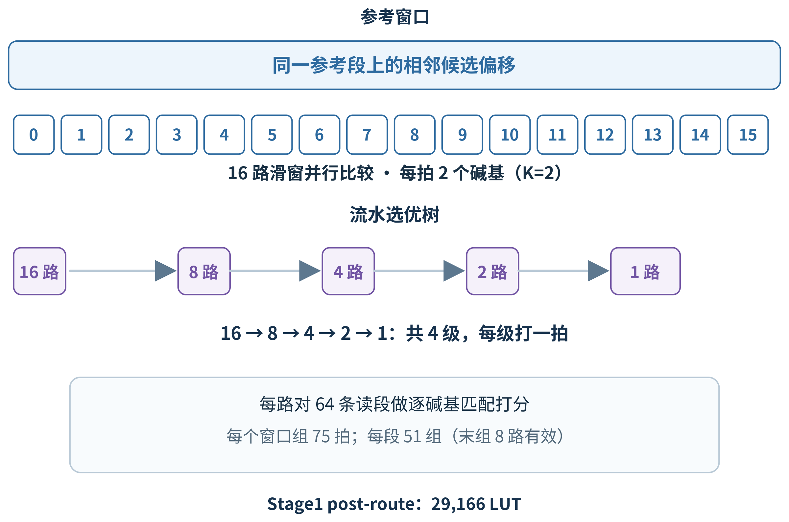

图 A1　Stage1 的 16 路滑窗与流水选优树

图中各路候选经分级比较收敛为一路输出，与正文所列的 16 路选优结构相对应。

各阶段的配置边界、t_result 与定版资源时序汇总于表 A1。

表 A1　分阶段性能与资源

| 阶段 | 配置 / 边界 | t_result | 结论 |
| --- | --- | --- | --- |
| 基线 | P4，K=1；3 次运行中位数 | 26.54 s | 同类任务基准 |
| 并行度 | P16，K=1；3 次运行中位数 | 8.95 s | 相对 P4 为 2.97× |
| 每拍碱基数 | P16，K=2；同小时 A/B | 9.08 → 6.06 s | 1.50× |
| 2026.1 定版 | 2 h 板测，262 轮 | 中位数 5.12 s | 独立版本与验证窗口 |
| 资源 / 时序 | 2026.1，100 MHz，post-route | LUT 36,731；FF 38,437 | WNS +0.089 ns；WHS +0.030 ns |

评估结果表明，提高每拍碱基并行度会受到器件资源和地址生成时序约束；更高时钟频率的估算也未满足时序要求，因此定版维持 100 MHz。各未采用方向及其证据见表 A2。

表 A2　评估后未采用的实现方向

| 方向 | 证据 | 决策 |
| --- | --- | --- |
| Stage1 P_WAYS=32/64 | 整机资源外推分别约 58.7k / 108k LUT | 超过器件容量 |
| 每拍 K=4 | 63,246 LUT；布局阶段失败 | 超过器件容量 |
| 每拍 K=3 | OOC WNS −15.244 ns，地址路径有除以 3 运算 | 时序不满足 |
| 时钟高于 100 MHz | 105/110/125 MHz WNS 估算为负；最差路径在 LDPC | 保持 100 MHz |
| 功耗评估 | 尚无板端功耗测量 | 列入后续工作，不作功耗结论 |

# 附录 B　大模型协作记录

大模型辅助用于检索资料、归纳日志、整理文档和协助局部实现。项目结论回到源码、构建报告和板端证据复核；模型输出不作为功能通过或性能结论的证据。各项用途对应的复核方式列于表 B1。

复核中识别并纠正了四类技术问题：仿真语言标准与源文件不匹配；等价测试将同一文件路径同时作为输入和参考，未形成有效对照；JTAG 空扫描被误读为设备识别结果；制品清单签名范围没有覆盖应纳入的内容。相关修改分别回到仿真配置与源文件、测试数据独立性、扫描返回状态和清单签名范围核查，并由独立构建或板端证据复验。

表 B1　大模型辅助的用途与复核方式

| 用途 | 复核方式 |
| --- | --- |
| 检索 | 回到原始资料核对定义、版本和适用范围 |
| 日志归纳 | 对照原始记录复核关键信息和状态顺序 |
| 文档整理 | 逐项核对现有报告、事实表与证据口径 |
| 局部实现辅助 | 检查源码改动，并以独立构建或板端证据复核结果 |

# 附录 C　技能包的提炼过程

技能包从工程问题和复核记录中提炼，按触发条件确定适用范围，再整理操作步骤、失效条件和独立复验方式。该过程使使用者能够先判断问题是否适用，再按可检查的步骤复现，并在结论形成前确认复验结果。表 C1 列出各技能包及其用途。

表 C1　技能包一览

| 技能包 | 用途 |
| --- | --- |
| board-bringup-debug | 分层定位 USB、JTAG、串口、PHY、网络和 CAPS 问题 |
| fpga-timing-probe | 在修改 RTL 前评估器件资源和时序可行性 |
| bottleneck-attribution | 区分 FPGA、DMA、网络和 PS 软件耗时 |
| accel-vs-cpu-baseline | 规范不同计算实现的比较边界 |
| board-stage-evidence | 用逐级判据定位板端处理错误 |
| ip-packaging-hygiene | 核对仿真、综合源集及 IP 打包身份 |
| ai-agent-collaboration | 为协作任务整理范围、步骤与复核边界 |
| claims-ledger | 区分实测、估算、旧版本数据和未验证结论 |

# 附录 D　复现说明

复现环境为 Windows 与 Vivado/Vitis 2026.1，目标器件为 XC7Z020。建议从空白构建目录开始，并在各步骤保留生成的报告、制品身份和哈希记录。

1. 硬件构建：根据 `build/build.config` 设置构建参数，运行 `build/run_build.bat` 生成硬件实现；核对器件、频率、Stage1 参数及布线后报告。
2. 软件构建：使用 `src/sw/scripts/run_vitis_modern.ps1` 创建并构建 Vitis 应用、FSBL 与 BOOT.bin。
3. 制品封装：运行 `src/tools/make_artifact_package.py` 生成制品清单与哈希记录，并运行 `src/tools/write_source_manifest.py` 记录源码清单和固件构建身份。
4. 板端验收：在板卡连接完成后运行 `src/tools/run_g3.sh`；按需使用 `src/tools/board_stage_check.py` 检查分级结果，并将本轮记录归入 `board/run-logs`。
5. 模拟回归：运行 `src/tools/run_sim.sh`，使用 `data/r083-data` 中的回归数据，保存运行状态和结果。
6. 交付核对：查看 `report/third-party-notices.md`、`readme.md` 和 `license`，确认分发说明随制品保留。

预期验收结果为 G3 架构判据 syndrome 全零（0/10,800）且系统判据载荷 SHA-256 命中。2026.1 定版板测记录的 t_result 中位数为 5.12 s（2 h、262 轮、每轮 103,616 条记录、26 次恢复探针）；42 例模拟载荷结果为 26 PASS、16 SAFE_NOCONV、0 静默错误。v1.1 制品另有 8 h、1,736 轮、173 次恢复探针且 0 失败的长稳记录，该结果属于独立制品。
